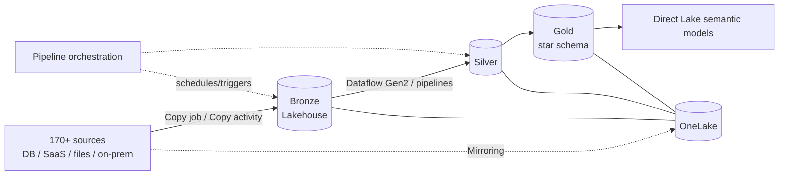

# Data Factory Best Practices

Based on [Data Factory in Fabric](https://learn.microsoft.com/en-us/fabric/data-factory/) and the [data movement decision guide](https://learn.microsoft.com/en-us/fabric/data-factory/decision-guide-data-movement)

## Overview

**Data Factory** is the ingestion and orchestration workload in Fabric — cloud-scale **data movement and transformation (ETL/ELT)** connecting **170+ sources** across multicloud and on-premises (via gateway). It's how raw data *lands in OneLake* to feed the Medallion pipeline, semantic models, and AI.

It offers several tools, each tuned to a different job:

| Tool | What it's for | Interface | Code |
|------|---------------|-----------|------|
| **[Data pipelines](https://learn.microsoft.com/en-us/fabric/data-factory/pipeline-support)** | Orchestration — chaining activities, control flow, parameterization, scheduling | Canvas | No/low |
| **[Copy job](https://learn.microsoft.com/en-us/fabric/data-factory/what-is-copy-job)** | Simplified ingestion — full/incremental copy, replication, [CDC](https://learn.microsoft.com/en-us/fabric/data-factory/cdc-copy-job) | Wizard | No/low |
| **[Copy activity](https://learn.microsoft.com/en-us/fabric/data-factory/copy-data-activity)** (in pipelines) | Ingestion inside an orchestrated, parameterized, metadata-driven flow | Canvas | No/low |
| **[Dataflow Gen2](https://learn.microsoft.com/en-us/fabric/data-factory/create-first-dataflow-gen2)** | Transformation / data prep — 300+ Power Query functions | Power Query | No/low |
| **[Mirroring](mirroring.md)** | Continuous replication of supported operational sources or metadata into OneLake; optional extended capabilities incur charges | Config | No code |
| **[dbt job](https://learn.microsoft.com/en-us/fabric/data-factory/dbt-job-overview)** | dbt Core transformations orchestrated in Fabric | Config + dbt project | Code |
| **[Apache Airflow jobs](https://learn.microsoft.com/en-us/fabric/data-factory/apache-airflow-jobs-concepts)** | Code-first orchestration (Python DAGs) for teams standardized on Airflow | DAG code | Code |

## Choosing the right tool

Match the tool to the job rather than forcing everything through pipelines. See the full [copy activity / Copy job / dataflow / Eventstream / Spark decision guide](https://learn.microsoft.com/en-us/fabric/fundamentals/decision-guide-pipeline-dataflow-spark).

| Need | Use |
|------|-----|
| Move data with little/no transformation | **Copy job** (or Copy activity if it's part of a larger flow) |
| Incremental copy, replication, or CDC | **Copy job** |
| Rich transformation / data prep / profiling | **Dataflow Gen2** |
| Orchestrate + schedule multi-step flows, parameterized/metadata-driven | **Pipelines** |
| Trigger business-app actions from a data workflow | **Business Actions activity** in a pipeline |
| Keep point-in-time Dataflow Gen2 query snapshots | **Back up query data to Lakehouse** |
| Continuously replicate a supported operational database into OneLake | **[Mirroring](mirroring.md)** |
| Heavy/complex big-data transformation | **[Spark notebooks](data-engineering.md)** |
| Real-time / event-driven ingestion | **[Real-Time hub](real-time-hub.md)** to discover/source streams, then **[Eventstreams (RTI)](real-time-intelligence.md)** to process and route |
| dbt-standardized SQL transformations | **dbt job** |
| Code-first DAG orchestration | **Apache Airflow jobs** |

### Data movement by Medallion layer

Official [data movement guidance](https://learn.microsoft.com/en-us/fabric/data-factory/decision-guide-data-movement) maps neatly onto [Medallion](medallion-architecture.md):

| Scenario | Recommended | Why |
|----------|-------------|-----|
| **Already-curated Gold data** (ETL done elsewhere) | **[Mirroring](mirroring.md)** | Minimal setup and continuous replication into OneLake for supported sources |
| **Bronze raw ingestion** | **Copy job** | Native incremental load, schema mapping, scheduling — no pipeline complexity |
| **Real-time streaming** | **[Eventstreams](real-time-intelligence.md)** | Low-latency, no-code routing to multiple destinations |
| **Complex orchestration** | **Pipelines + Copy activity** | Parameterization and metadata-driven ingestion |

## Best practices

### Placement & architecture
- ✅ **Land data in OneLake** — target a Lakehouse or Warehouse so ingested data is immediately governed, in Delta, and available to Spark, Warehouse, and [Direct Lake](direct-lake.md). Don't stage in external storage first.
- ✅ **Ingest into Bronze, transform toward Gold** — use Data Factory to land raw data, then conform/curate through the [Medallion](medallion-architecture.md) layers rather than doing all transformation inline at ingest.
- ✅ **Prefer Mirroring for already-curated / operational sources** — skip hand-built copy pipelines when [Mirroring](mirroring.md) or an auto-replicating [Fabric database](databases-in-fabric.md) already lands the data in OneLake. Core mirroring compute is free, but [extended capabilities](https://learn.microsoft.com/en-us/fabric/mirroring/extended-capabilities-billing), source-side usage, storage beyond included limits, and downstream processing can incur costs.
- ✅ **Plan connectivity before tool selection** — source location and network controls determine whether you need direct connectors, mirroring, gateways, VNet gateways, managed private endpoints, or trusted workspace access. See [data gateway and connectivity guidance](data-gateways.md).

### Movement & transformation
- ✅ **Use Copy job for incremental & CDC** — [Copy job](https://learn.microsoft.com/en-us/fabric/data-factory/what-is-copy-job) handles full, incremental, and [change data capture](https://learn.microsoft.com/en-us/fabric/data-factory/cdc-copy-job) natively; don't re-copy full datasets each run.
- ✅ **Re-check native connector coverage before custom ingestion** — Fabric connector coverage changes frequently, including database and SaaS sources. Prefer supported connectors and managed connections over hand-built API extracts when the connector meets latency, schema, and security requirements.
- ✅ **Enable Fast Copy in Dataflow Gen2** for large-volume ingestion — [Fast Copy](https://learn.microsoft.com/en-us/fabric/data-factory/dataflows-gen2-fast-copy) uses the scalable copy backend under Power Query.
- ✅ **Push heavy transformation to the right engine** — Power Query (Dataflow Gen2) for data prep; [Spark](data-engineering.md) for big-data/complex logic. Keep copy activities lightweight (type conversion, column mapping).
- ✅ **Evaluate Mapping Data Flow transforms when migrating existing ADF flows** — the [built-in upgrade for eligible Azure Data Factory pipelines](https://learn.microsoft.com/en-us/fabric/data-factory/dataflow-gen2-mapping-data-flows-transforms-upgrade) is generally available. Run converted transforms through a pipeline Dataflow activity, not direct Dataflow Gen2 refresh, and compare output with the original before cutover.
- ✅ **Parameterize and go metadata-driven** — drive Copy activity with parameters so one pipeline ingests many tables, instead of duplicating pipelines per source.
- ✅ **Use Dataflow Gen2 backup for snapshot evidence** — when data prep output needs point-in-time evidence or simple retention, back up query results to a Lakehouse; don't treat it as a full change-comparison or audit subsystem.

### Orchestration & operations
- ✅ **Orchestrate with pipelines; trigger by schedule or event** — use [storage-event triggers](https://learn.microsoft.com/en-us/fabric/data-factory/pipeline-storage-event-triggers) for event-driven runs and schedules for batch.
- ✅ **Use utility activities for deterministic downstream state** — after ingestion, use Refresh Materialized Lake View or Refresh SQL analytics endpoint activities when downstream analytics need an explicit freshness point; use Approval activity only for real business or compliance decision gates, not routine operator babysitting.
- ✅ **Use Business Actions for business-system side effects** — call approved Logic Apps connector actions from pipelines when a data-quality result, exception, or operational condition should notify or update a business system; keep connector credentials and approval expectations explicit.
- ✅ **Monitor runs** — use [pipeline run monitoring](https://learn.microsoft.com/en-us/fabric/data-factory/monitor-pipeline-runs) and build in retries/alerts for resilient ingestion.
- ✅ **Manage lifecycle with Git + deployment pipelines** — put pipelines/dataflows under [CI/CD](https://learn.microsoft.com/en-us/fabric/data-factory/cicd-pipelines) and promote Dev → Test → Prod. See [CI/CD deployment](ci-cd-deployment.md).
- ✅ **Reach on-premises data through a gateway** — use the [on-premises data gateway](https://learn.microsoft.com/en-us/fabric/data-factory/how-to-access-on-premises-data) for hybrid sources instead of copying data out manually.

### Migration from Azure Data Factory
- ✅ **Plan ADF migrations** using the [migration planning guide](https://learn.microsoft.com/en-us/fabric/data-factory/migrate-planning-azure-data-factory) and [ADF vs. Fabric Data Factory comparison](https://learn.microsoft.com/en-us/fabric/data-factory/compare-fabric-data-factory-and-azure-data-factory).
- ✅ **Use the Fabric upgrade path incrementally** — assess Azure Data Factory pipelines, migrate candidates in controlled waves, and keep rollback/source-of-truth clear instead of doing a blind lift-and-shift into Fabric.

## Anti-patterns

- 🚫 **Landing ingested data outside OneLake** — staging in external ADLS/blob first defeats the single-copy, single-governance model. Target a Lakehouse/Warehouse directly.
- 🚫 **Building custom copy pipelines when Mirroring or auto-replication exists** — for operational databases and mirrored sources, replication into OneLake is free/automatic; hand-rolled ETL adds latency, cost, and drift.
- 🚫 **Full reloads every run** — use Copy job incremental/CDC instead of re-copying entire datasets.
- 🚫 **Cramming heavy transformation into copy activities** — copy is for lightweight mapping; use Dataflow Gen2 or Spark for real transformation logic.
- 🚫 **One pipeline per source table** — parameterize a metadata-driven pipeline instead of duplicating logic.
- 🚫 **Custom API extraction when a supported connector fits** — creates avoidable maintenance, auth, throttling, and schema-drift work.
- 🚫 **No source control or manual prod edits** — unversioned pipelines can't be reviewed, tested, or rolled back; use Git integration and deployment pipelines.
- 🚫 **Using Dataflow backup as an audit engine** — backup snapshots preserve point-in-time query results, but they don't compare changes or replace controlled audit/lineage design.
- 🚫 **Manual post-load refresh steps** — if Lakehouse SQL endpoints or materialized lake views must be current before reports/exports run, orchestrate the refresh in the pipeline instead of relying on ad hoc portal clicks.
- 🚫 **DirectQuery to the operational source for BI** — ingest to OneLake and serve with Direct Lake rather than hammering source systems.

## References

- [Data Factory in Fabric documentation](https://learn.microsoft.com/en-us/fabric/data-factory/)
- [What is Data Factory?](https://learn.microsoft.com/en-us/fabric/data-factory/data-factory-overview)
- [Data movement decision guide (Mirroring / Copy job / Copy activity / Eventstreams)](https://learn.microsoft.com/en-us/fabric/data-factory/decision-guide-data-movement)
- [Copy activity, Copy job, dataflow, Eventstream, or Spark decision guide](https://learn.microsoft.com/en-us/fabric/fundamentals/decision-guide-pipeline-dataflow-spark)
- [Connectivity patterns in Microsoft Fabric: A guide for data integration workloads](https://community.fabric.microsoft.com/blog/fbc_fabricupdatesblogs/connectivity-patterns-in-microsoft-fabric-a-guide-for-data-integration-workloads/5360180)
- [Mirroring in Fabric](https://learn.microsoft.com/en-us/fabric/mirroring/overview)
- [What is Copy job?](https://learn.microsoft.com/en-us/fabric/data-factory/what-is-copy-job)
- [Change data capture in Copy job](https://learn.microsoft.com/en-us/fabric/data-factory/cdc-copy-job)
- [Copy activity in pipelines](https://learn.microsoft.com/en-us/fabric/data-factory/copy-data-activity)
- [Create your first Dataflow Gen2](https://learn.microsoft.com/en-us/fabric/data-factory/create-first-dataflow-gen2)
- [Fast Copy in Dataflow Gen2](https://learn.microsoft.com/en-us/fabric/data-factory/dataflows-gen2-fast-copy)
- [Back up query data to a Lakehouse with Dataflow Gen2](https://learn.microsoft.com/en-us/fabric/data-factory/back-up-query-data-lakehouse)
- [Connector overview (170+ sources)](https://learn.microsoft.com/en-us/fabric/data-factory/connector-overview)
- [Access on-premises data with a gateway](https://learn.microsoft.com/en-us/fabric/data-factory/how-to-access-on-premises-data)
- [Apache Airflow jobs](https://learn.microsoft.com/en-us/fabric/data-factory/apache-airflow-jobs-concepts)
- [dbt job overview](https://learn.microsoft.com/en-us/fabric/data-factory/dbt-job-overview)
- [Storage event triggers](https://learn.microsoft.com/en-us/fabric/data-factory/pipeline-storage-event-triggers)
- [Monitor pipeline runs](https://learn.microsoft.com/en-us/fabric/data-factory/monitor-pipeline-runs)
- [Approval activity](https://learn.microsoft.com/en-us/fabric/data-factory/approval-activity)
- [Business Action activity](https://learn.microsoft.com/en-us/fabric/data-factory/business-actions-activity)
- [Refresh Materialized Lake View activity](https://learn.microsoft.com/en-us/fabric/data-factory/refresh-materialized-lake-view-activity)
- [Refresh SQL analytics endpoint activity](https://learn.microsoft.com/en-us/fabric/data-factory/refresh-sql-endpoint-activity)
- [CI/CD for Data Factory](https://learn.microsoft.com/en-us/fabric/data-factory/cicd-pipelines)
- [Migrate to Fabric Data Factory (planning)](https://learn.microsoft.com/en-us/fabric/data-factory/migrate-planning-azure-data-factory)
- [Compare Azure Data Factory to Fabric Data Factory](https://learn.microsoft.com/en-us/fabric/data-factory/compare-fabric-data-factory-and-azure-data-factory)
- [Upgrade Azure Data Factory pipelines to Fabric Data Factory](https://learn.microsoft.com/en-us/fabric/data-factory/how-to-upgrade-your-azure-data-factory-pipelines-to-fabric-data-factory)
