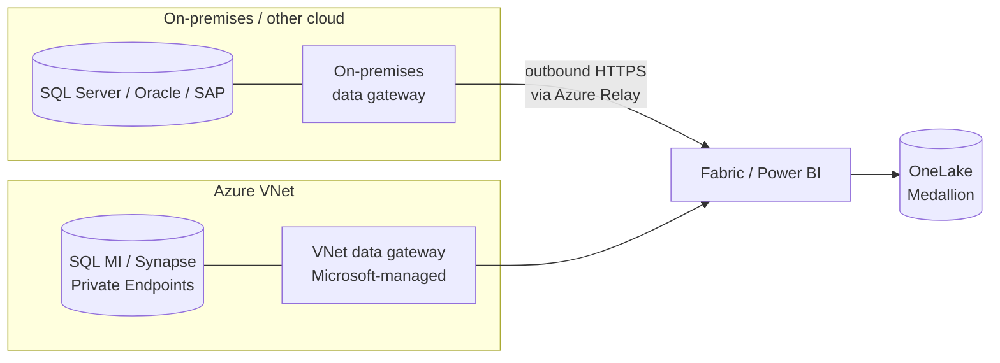

# Data Gateways Best Practices

Based on [On-premises data gateway](https://learn.microsoft.com/en-us/data-integration/gateway/service-gateway-onprem), [Virtual network (VNet) data gateway](https://learn.microsoft.com/en-us/data-integration/vnet/overview), and [Connectivity patterns in Microsoft Fabric](https://community.fabric.microsoft.com/blog/fbc_fabricupdatesblogs/connectivity-patterns-in-microsoft-fabric-a-guide-for-data-integration-workloads/5360180)

## Overview

A **data gateway** is the secure bridge that lets Fabric (and the Power Platform) reach data sources that don't sit on a public endpoint — on-premises databases, private Azure resources behind a VNet, and other-cloud sources reached through ExpressRoute/VPN. It brokers queries and returns results **without exposing the source to the public internet**. Gateways power many Data Factory, Dataflow Gen2, Copy job, Mirroring, and Power BI semantic model / paginated report scenarios, but support varies by workload and connector.

There are two enterprise gateway types. Pick based on *where the source lives*, not habit:

| Gateway | Best for | Hosting | Notes |
|---------|----------|---------|-------|
| **[On-premises data gateway (standard)](https://learn.microsoft.com/en-us/data-integration/gateway/service-gateway-onprem)** | On-premises and non-Azure sources (SQL Server, Oracle, SAP, file shares) | You install & run it on a Windows VM you own | Shared by the whole org; supports clustering |
| **[VNet data gateway](https://learn.microsoft.com/en-us/data-integration/vnet/overview)** | Azure sources behind a VNet / private endpoints (SQL MI, Synapse, PaaS with Private Link) | **Fully managed by Microsoft** — no VM to patch | More cost-effective than running your own VM; provides compute isolation |

> A third type, the **on-premises data gateway (personal mode)**, exists for individual Power BI refresh only. Don't use it for shared/production workloads — it can't be clustered or shared.

## Choosing the right gateway

| Source location | Source type | Recommended |
|-----------------|-------------|-------------|
| On-premises | Any (SQL Server, Oracle, SAP, files) | On-premises data gateway (standard) |
| Azure, behind VNet / Private Link | SQL MI, Synapse, PaaS | VNet data gateway; validate workload/connector support before standardizing |
| Azure, public endpoint | ADLS Gen2, PaaS | Often no gateway — use [trusted workspace access](https://learn.microsoft.com/en-us/fabric/security/security-trusted-workspace-access) / [managed private endpoints](https://learn.microsoft.com/en-us/fabric/security/security-managed-private-endpoints-overview) |
| Other cloud / internet SaaS | REST APIs | Direct connectors — no gateway needed |

> Reach on-premises sources in Data Factory through the gateway rather than exporting extracts by hand — see [Access on-premises data](https://learn.microsoft.com/en-us/fabric/data-factory/how-to-access-on-premises-data).

## Connectivity pattern selection

Choose the connectivity pattern from the source network boundary, security posture, workload support, and operational ownership model:

| Pattern | Use when | Watch-outs |
|---------|----------|------------|
| **Direct cloud connector** | The source has a supported public endpoint and access can be governed through identity, firewall rules, and Fabric connection management. | Avoid opening broad source firewalls just to make a connector work. |
| **On-premises data gateway** | The source is on-premises, in another cloud, or otherwise reachable from a customer-managed Windows host. | Own the VM, patching, sizing, clustering, and Azure Relay/data-residency decisions. |
| **VNet data gateway** | The source is an Azure resource behind a VNet or private endpoint and the workload/connector supports VNet gateway use. | Validate connector support, region, subscription, and resource group choices before standardizing. |
| **Managed private endpoint / trusted workspace access** | Fabric workloads need private access to protected Azure resources without routing through a self-managed gateway host. | Requires workspace and source-resource admin coordination, private endpoint approval, and workload support validation. |
| **Mirroring or built-in replication** | An operational source can replicate into OneLake through a supported Fabric-native path. | Prefer this over custom copy pipelines when the source and requirements fit. |

## Best practices

### Connectivity planning

- ✅ **Start with source location and network boundary** — decide whether the source is public cloud, private Azure, on-premises, another cloud, or SaaS before choosing a gateway or private endpoint pattern.
- ✅ **Validate workload and connector support** — gateway, VNet gateway, managed private endpoint, mirroring, Data Factory, Dataflow Gen2, and Power BI support can differ by connector and workload.
- ✅ **Prefer the simplest governed path** — use direct connectors, mirroring, trusted workspace access, or managed private endpoints when they satisfy security requirements; introduce gateways when a network bridge is actually needed.

### Deployment & sizing

- ✅ **Run the standard gateway on a dedicated server**, not a user workstation or a box shared with other heavy workloads — resource contention degrades every refresh. Follow the [performance and sizing guidance](https://learn.microsoft.com/en-us/data-integration/gateway/service-gateway-performance).
- ✅ **Place the gateway close to the data source** (same network/region) to minimize latency — the gateway-to-source hop is usually where refresh time is won or lost.
- ✅ **Prefer the VNet data gateway for Azure-resident sources** — it's Microsoft-managed (no OS/gateway patching), gives compute isolation, and avoids standing up a VM just to reach private endpoints.

### High availability

- ✅ **Cluster standard gateways** (2+ members) so a single node failure doesn't halt refreshes — see [high-availability clusters](https://learn.microsoft.com/en-us/data-integration/gateway/service-gateway-high-availability-clusters).
- ✅ **Keep all cluster members on the same gateway version** and identical data-source configuration; the service load-balances requests across healthy members.

### Updates & monitoring

- ✅ **Keep auto-update enabled** on standard gateways — only the last six monthly releases are supported. (The VNet gateway is updated by Microsoft.)
- ✅ **Monitor gateway health and connectivity** and [manage the gateway](https://learn.microsoft.com/en-us/data-integration/gateway/service-gateway-manage) proactively; wire up alerts so a down node is caught before users report failed reports. Use the [troubleshooting guide](https://learn.microsoft.com/en-us/data-integration/gateway/service-gateway-tshoot) for connectivity issues.

### Security & governance

- ✅ **Restrict gateway admin roles** to the infrastructure/COE team using [gateway security roles](https://learn.microsoft.com/en-us/data-integration/gateway/manage-security-roles); gateway admins effectively control which sources are reachable.
- ✅ **Never expose the gateway machine to the public internet** — it only needs *outbound* HTTPS. Configure firewalls per the [communication settings](https://learn.microsoft.com/en-us/data-integration/gateway/service-gateway-communication) rather than opening broad inbound rules.
- ✅ **Use the VNet gateway with private endpoints** so source traffic never touches a public endpoint.
- ✅ **Allow the documented Fabric/gateway endpoints** through firewalls and private-network rules; some paths, such as Dataflow Gen2 to SQL Server through a VNet gateway, still require planning for SQL port 1433.

## Keeping data in-region (bring your own relay)

For regulated or data-residency-sensitive workloads, the concern is: *does my data leave its home region in transit?* By default, when you install a standard gateway an **Azure Relay is auto-provisioned in the region you selected** for the gateway, and data flows source → relay → Power BI/Fabric capacity.

You can control this with **bring your own relay (BYOR)** — see [Set the Azure Relay for on-premises data gateway](https://learn.microsoft.com/en-us/data-integration/gateway/service-gateway-azure-relay):

- ✅ **Provide your own [Azure Relay](https://learn.microsoft.com/en-us/azure/azure-relay/relay-what-is-it) that lives in the same region as the data.** During gateway registration choose **Provide relay details** and supply the WCF Relay (NetTcp) endpoint URI plus `SendAccessKey` / `ListenAccessKey` shared-access policies.
- ✅ **Make sure your Fabric/Power BI capacity is in that same region** too.
- ✅ **Net effect:** when relay, capacity, and data are all co-located in one region, **your data stays in that region** — only *metadata* travels to the gateway application in the home tenant region, and that path can't be changed.

**Constraints to plan around:**

- ⚠️ Only **WCF relays with NetTcp** type are supported for BYOR.
- ⚠️ **Azure Relay configured with Private Link isn't supported.**
- ⚠️ The **WCF Relay endpoint URI must be unique per gateway** — don't reuse one relay across gateways.
- ⚠️ If you recover a gateway with custom relay details onto a new machine, **uninstall the old gateway or rotate the send/listen keys**, or queries can fail.
- ⚠️ For the **VNet data gateway**, you can't change the region, subscription, or resource group of the VNet after creation — pick the correct region up front.

## Anti-patterns

- 🚫 **Personal-mode gateway for production** — no clustering, tied to one user; a leaver or a reboot breaks scheduled refreshes.
- 🚫 **Single, un-clustered gateway for critical pipelines** — a single point of failure for every dependent report and pipeline.
- 🚫 **Hand-exporting on-prem extracts to cloud storage** instead of connecting through a gateway — creates stale, ungoverned copies and defeats OneLake-first lineage.
- 🚫 **Choosing a gateway by habit** — using an on-premises gateway for every private source can add avoidable operational overhead when VNet gateways, managed private endpoints, trusted workspace access, mirroring, or direct connectors are a better fit.
- 🚫 **Ignoring relay region for regulated data** — accepting the default relay when residency rules apply, when BYOR + co-located capacity would keep data in-region.
- 🚫 **Running the gateway on a shared/under-spec box** and letting auto-update lapse — the top causes of flaky refreshes and unsupported versions.
- 🚫 **Standing up a self-managed VM gateway for Azure PaaS sources** when a managed VNet data gateway (or trusted workspace access / managed private endpoints) would be simpler and cheaper.

## References

- [On-premises data gateway overview](https://learn.microsoft.com/en-us/data-integration/gateway/service-gateway-onprem)
- [Connectivity patterns in Microsoft Fabric: A guide for data integration workloads](https://community.fabric.microsoft.com/blog/fbc_fabricupdatesblogs/connectivity-patterns-in-microsoft-fabric-a-guide-for-data-integration-workloads/5360180)
- [Install an on-premises data gateway](https://learn.microsoft.com/en-us/data-integration/gateway/service-gateway-install)
- [Gateway performance and sizing](https://learn.microsoft.com/en-us/data-integration/gateway/service-gateway-performance)
- [High-availability clusters](https://learn.microsoft.com/en-us/data-integration/gateway/service-gateway-high-availability-clusters)
- [Adjust communication settings (ports/FQDNs)](https://learn.microsoft.com/en-us/data-integration/gateway/service-gateway-communication)
- [Set the Azure Relay (bring your own relay / keep data in region)](https://learn.microsoft.com/en-us/data-integration/gateway/service-gateway-azure-relay)
- [Manage gateway security roles](https://learn.microsoft.com/en-us/data-integration/gateway/manage-security-roles)
- [Troubleshoot the on-premises data gateway](https://learn.microsoft.com/en-us/data-integration/gateway/service-gateway-tshoot)
- [What is a VNet data gateway](https://learn.microsoft.com/en-us/data-integration/vnet/overview)
- [Create VNet data gateways](https://learn.microsoft.com/en-us/data-integration/vnet/create-data-gateways)
- [Use VNet data gateways with Power BI](https://learn.microsoft.com/en-us/data-integration/vnet/use-data-gateways-sources-power-bi)
- [Access on-premises data in Data Factory](https://learn.microsoft.com/en-us/fabric/data-factory/how-to-access-on-premises-data)
