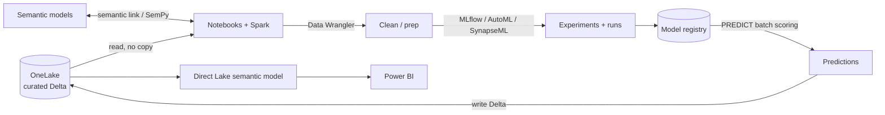

# Data Science Best Practices

Based on [Data Science in Fabric](https://learn.microsoft.com/en-us/fabric/data-science/) and the [Data Science overview](https://learn.microsoft.com/en-us/fabric/data-science/data-science-overview)

## Overview

**Fabric Data Science** is the ML/AI workload for building **end-to-end machine learning workflows** — from data prep to modeling to serving predictions — **directly on governed data in OneLake**. Because it operates on the same Delta tables as Data Engineering and BI, there's no data movement between systems: data scientists read curated Lakehouse/Warehouse data, train models, and write predictions back to OneLake where Power BI consumes them via [Direct Lake](direct-lake.md).

It complements [Data Engineering](data-engineering.md) (Spark is the shared compute) and feeds the [Fabric Data Agent](../fabric-data-agents/data-architecture-for-agents.md) estate.

### The data science process → Fabric capabilities

| Step | Fabric capability |
|------|-------------------|
| **Discover & preprocess** | [Notebooks](https://learn.microsoft.com/en-us/fabric/data-science/tutorial-data-science-introduction) + Spark, [OneLake shortcuts](onelake-shortcuts.md) for no-copy access, [Data Wrangler](https://learn.microsoft.com/en-us/fabric/data-science/data-wrangler) for code-generating data cleaning |
| **Experiment & model** | [MLflow experiments](https://learn.microsoft.com/en-us/fabric/data-science/machine-learning-experiment) (built-in tracking), [AutoML](https://learn.microsoft.com/en-us/fabric/data-science/automated-machine-learning-fabric), [SynapseML](https://learn.microsoft.com/en-us/fabric/data-science/synapseml-first-model) for scalable pipelines |
| **Register & version** | [ML models](https://learn.microsoft.com/en-us/fabric/data-science/machine-learning-model) in the Fabric model registry (MLflow-backed) |
| **Enrich & operationalize** | Scalable [`PREDICT`](https://learn.microsoft.com/en-us/fabric/data-science/model-scoring-predict) batch scoring, [AI functions](https://learn.microsoft.com/en-us/fabric/data-science/ai-functions/overview), and scheduled notebooks/pipelines |
| **Ground agents** | Fabric data agents and Foundry tools over governed OneLake, Eventhouse, semantic model, and warehouse sources |
| **Build insights** | Predictions written to OneLake → Power BI [Direct Lake](direct-lake.md); [semantic link (SemPy)](https://learn.microsoft.com/en-us/fabric/data-science/semantic-link-overview) bridges semantic models and data science |

## Best practices

### Data access & preparation
- ✅ **Read curated data in place from OneLake** — attach a Lakehouse to a notebook and read directly into Spark/Pandas; use [shortcuts](onelake-shortcuts.md) for no-copy access to external or cross-tenant data instead of duplicating.
- ✅ **Train on conformed Silver/Gold, not raw Bronze** — ground models on governed, quality data from the [Medallion](medallion-architecture.md) pipeline.
- ✅ **Use [Data Wrangler](https://learn.microsoft.com/en-us/fabric/data-science/data-wrangler) for cleaning** — it generates reusable Python/PySpark code, making prep repeatable and automatable rather than ad-hoc.
- ✅ **Prep at scale with Spark** — PySpark, Scala, Spark SQL, and Pandas API on Spark; follow the [Data Engineering best practices](data-engineering.md) for performance.

### Experimentation & modeling
- ✅ **Track everything with MLflow** — Fabric has [built-in MLflow](https://learn.microsoft.com/en-us/fabric/data-science/machine-learning-experiment); use [autologging](https://learn.microsoft.com/en-us/fabric/data-science/mlflow-autologging) so parameters, metrics, and artifacts are captured for every run and are reproducible/comparable.
- ✅ **Register models in the model registry** — version [ML models](https://learn.microsoft.com/en-us/fabric/data-science/machine-learning-model) via MLflow so scoring references a governed, versioned artifact — not a loose pickle file.
- ✅ **Use [AutoML](https://learn.microsoft.com/en-us/fabric/data-science/automated-machine-learning-fabric)** to baseline quickly, and **[SynapseML](https://learn.microsoft.com/en-us/fabric/data-science/synapseml-first-model)** for massively scalable ML pipelines.
- ✅ **Manage libraries with Environments** — pin runtime and library versions in a Fabric Environment for reproducibility across dev and prod.

### Operationalize & serve
- ✅ **Batch score with `PREDICT`** — the scalable [universal Spark PREDICT](https://learn.microsoft.com/en-us/fabric/data-science/model-scoring-predict) runs MLflow-registered models over big data; schedule via notebooks or [Data Factory](data-factory.md) pipelines.
- ✅ **Use AI functions for governed enrichment** — apply built-in AI transformations when text/image extraction, classification, translation, or summarization belongs in the data preparation flow.
- ✅ **Write predictions to OneLake as Delta** and serve with **[Direct Lake](direct-lake.md)** — Power BI picks up fresh predictions with no data loads or refreshes.
- ✅ **Bridge BI and DS with [semantic link / SemPy](https://learn.microsoft.com/en-us/fabric/data-science/semantic-link-overview)** — read semantic models (and their measures) into notebooks, reusing analysts' business logic instead of reimplementing it.

### Governance & collaboration
- ✅ **Keep DS on the governed platform** — models and predictions inherit OneLake lineage, Purview governance, and Entra security. See [security best practices](../security/best-practices.md).
- ✅ **Manage lifecycle with Git + deployment pipelines** — version notebooks and promote Dev → Test → Prod. See [CI/CD deployment](ci-cd-deployment.md).
- ✅ **Feed the agent/IQ estate** — registered models and prediction tables are governed sources for [data agents and Fabric IQ](../fabric-data-agents/ontologies-fabric-iq.md).

## Anti-patterns

- 🚫 **Exporting data out of Fabric to train elsewhere** — read governed data in place from OneLake; moving it breaks lineage, governance, and freshness.
- 🚫 **Untracked experiments** — training without MLflow means no reproducibility or run comparison; always log experiments and runs.
- 🚫 **Deploying loose model files** — register models in the model registry for versioning and governed scoring instead of passing pickles around.
- 🚫 **DirectQuery / re-importing to serve predictions** — write predictions to OneLake and serve with Direct Lake; don't copy them into an import model.
- 🚫 **Row-by-row scoring in plain Python** — use scalable `PREDICT` (or Spark) for batch inference over large datasets.
- 🚫 **Reimplementing business logic already in semantic models** — use semantic link to reuse analysts' measures rather than re-deriving them.
- 🚫 **Training on raw Bronze data** — model on conformed Silver/Gold so models learn from governed, quality data.

## References

- [Data Science in Fabric documentation](https://learn.microsoft.com/en-us/fabric/data-science/)
- [Data Science overview](https://learn.microsoft.com/en-us/fabric/data-science/data-science-overview)
- [Data Science end-to-end tutorial](https://learn.microsoft.com/en-us/fabric/data-science/tutorial-data-science-introduction)
- [Data Wrangler](https://learn.microsoft.com/en-us/fabric/data-science/data-wrangler)
- [Machine learning experiments (MLflow)](https://learn.microsoft.com/en-us/fabric/data-science/machine-learning-experiment)
- [MLflow autologging](https://learn.microsoft.com/en-us/fabric/data-science/mlflow-autologging)
- [Machine learning models](https://learn.microsoft.com/en-us/fabric/data-science/machine-learning-model)
- [Automated ML (AutoML)](https://learn.microsoft.com/en-us/fabric/data-science/automated-machine-learning-fabric)
- [SynapseML](https://learn.microsoft.com/en-us/fabric/data-science/synapseml-first-model)
- [Model scoring with PREDICT](https://learn.microsoft.com/en-us/fabric/data-science/model-scoring-predict)
- [Semantic link (SemPy) overview](https://learn.microsoft.com/en-us/fabric/data-science/semantic-link-overview)
- [Semantic link and Power BI](https://learn.microsoft.com/en-us/fabric/data-science/semantic-link-power-bi)
- [AI functions overview](https://learn.microsoft.com/en-us/fabric/data-science/ai-functions/overview)
- [Create a Fabric data agent](https://learn.microsoft.com/en-us/fabric/data-science/how-to-create-data-agent)
