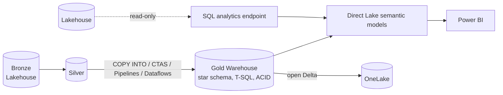

# Data Warehouse Best Practices

Based on [Data Warehouse in Fabric](https://learn.microsoft.com/en-us/fabric/data-warehouse/), the [Warehouse vs. Lakehouse decision guide](https://learn.microsoft.com/en-us/fabric/fundamentals/decision-guide-lakehouse-warehouse), and [Data Warehouse development and deployment](https://learn.microsoft.com/en-us/fabric/data-warehouse/development-deployment)

## Overview

**Fabric Data Warehouse** is an **enterprise-scale relational warehouse on a data-lake foundation** — a "lake warehouse." It's developed primarily in **T-SQL**, offers **full multi-table ACID transactions** (DDL + DML, stored procedures, views, functions), and — like all Fabric data — stores everything as **open Delta/Parquet in OneLake**. Storage and compute are separated, so it scales near-instantly with autonomous, "no-knobs" workload management.

It's the right home for the **curated, governed serving layer**: star/snowflake schemas, corporate data marts, and semantic models for BI.

The workload exposes **two items** — both built on the same SQL engine over OneLake Delta:

| Item | Read/write | Use when |
|------|-----------|----------|
| **[Warehouse](https://learn.microsoft.com/en-us/fabric/data-warehouse/data-warehousing)** | Full DDL + DML (T-SQL writes, multi-table transactions) | You need to load, transform, and serve with full transactional SQL |
| **[SQL analytics endpoint](https://learn.microsoft.com/en-us/fabric/data-engineering/lakehouse-sql-analytics-endpoint)** | Read-only T-SQL | You want to query a Lakehouse (or SQL database) over its Delta tables without moving data |

Every Lakehouse, Warehouse, and SQL database **auto-provisions a SQL analytics endpoint**, so T-SQL is a consistent query surface across the estate.

Power BI semantic models are now independent items. Default semantic models are no longer created automatically for new warehouse/lakehouse/mirrored items, and previously created default models are decoupled. Build and manage explicit custom semantic models for production BI.

## Warehouse or Lakehouse?

Both are enterprise-scale, open-format, and share the same T-SQL engine — choose by **how you develop** and **what you need**. See the full [decision guide](https://learn.microsoft.com/en-us/fabric/fundamentals/decision-guide-lakehouse-warehouse).

| Decision point | Warehouse | Lakehouse |
|----------------|-----------|-----------|
| **Primary dev tool** | T-SQL | Spark / notebooks |
| **Multi-table transactions** | ✅ Yes (full DML) | ❌ No |
| **Data types** | Structured / semi-structured | Any — structured + unstructured |
| **Persona** | DBA, SQL data engineer, analyst | Data engineer, data scientist |
| **Writes** | T-SQL, `COPY INTO`, pipelines, dataflows | Spark, then read-only via SQL endpoint |

> **Rule of thumb:** land and transform big/unstructured data in the **[Lakehouse](data-engineering.md)** (Bronze/Silver), then serve curated, governed **Gold** marts from the **Warehouse** when you need T-SQL and multi-table transactions. Both live in OneLake, so you can add either later without moving data.

## Best practices

### Placement & modeling
- ✅ **Use the Warehouse as the curated Gold serving layer** — star/snowflake schemas and data marts for BI, fed from conformed Silver. See [Medallion](medallion-architecture.md).
- ✅ **Model star schemas** — facts + dimensions, defined [table relationships](https://learn.microsoft.com/en-us/fabric/data-warehouse/data-modeling-defining-relationships); avoid wide denormalized "everything tables." See [semantic modeling](semantic-modeling.md).
- ✅ **Serve BI with [Direct Lake](direct-lake.md)** on the Warehouse's Delta tables when feasible — not DirectQuery as the default — for import-like performance on fresh data. Build an explicit [custom semantic model](https://learn.microsoft.com/en-us/fabric/data-warehouse/semantic-models) on top.
- ✅ **Query across stores without copying** — use cross-database queries and the SQL analytics endpoint to join Warehouse, Lakehouse, and SQL database data in place.

### Loading & transformation
- ✅ **Bulk load efficiently** — use [`COPY INTO`](https://learn.microsoft.com/en-us/fabric/data-warehouse/ingest-data), [pipelines](https://learn.microsoft.com/en-us/fabric/data-warehouse/ingest-data-pipelines), Dataflows, or `CTAS`/`INSERT..SELECT` for cross-database loads. Use [Data Factory](data-factory.md) to orchestrate ingestion.
- ✅ **Transform with set-based T-SQL** and multi-table transactions rather than row-by-row logic.
- ✅ **Let the engine tune itself** — autonomous workload management means [no manual knobs](https://learn.microsoft.com/en-us/fabric/data-warehouse/workload-management); keep [statistics](https://learn.microsoft.com/en-us/fabric/data-warehouse/statistics) healthy and follow the [performance guidelines](https://learn.microsoft.com/en-us/fabric/data-warehouse/guidelines-warehouse-performance).
- ✅ **Track GPU-accelerated query execution as a performance accelerator** — announced GPU acceleration for Fabric Warehouse targets eligible analytical SQL workloads without query rewrites, but treat it as preview/early-access until your tenant has validated support and workload fit.

### Governance & lifecycle
- ✅ **Secure with the SQL engine + OneLake** — object/column/row-level security, and align to the repo [security best practices](../security/best-practices.md). See [warehouse security](https://learn.microsoft.com/en-us/fabric/data-warehouse/security).
- ✅ **Put the Warehouse under source control** — [Git integration](https://learn.microsoft.com/en-us/fabric/data-warehouse/source-control) + deployment pipelines to promote Dev → Test → Prod. See [CI/CD deployment](ci-cd-deployment.md).
- ✅ **Use IDE and DacFx workflows where they fit** — for SQL-first teams, use Visual Studio Code or SSMS database projects, schema compare, SQL formatting, and DacFx-backed build/publish workflows to review Warehouse schema changes before deployment; validate current Fabric Warehouse support before standardizing production release gates.
- ✅ **Organize by domain** — build data marts / data mesh around business domains, not tools.

### Platform update: agent-assisted SQL still needs deployment discipline

SSMS Agent Mode, SQL Projects, Schema Compare, SQL Formatter, and Fabric Warehouse GPU acceleration all point in the same direction: faster SQL authoring and higher-throughput analytics. Keep the architecture rule unchanged: generated T-SQL and schema changes should flow through source control, schema compare, review, and deployment pipelines before production.

## Anti-patterns

- 🚫 **Using the Warehouse as an OLTP store** — it's an analytical serving engine; single-row operational writes belong in a [SQL database in Fabric](databases-in-fabric.md).
- 🚫 **DirectQuery BI against the Warehouse by default** — use [Direct Lake](direct-lake.md) semantic models when feasible; reserve DirectQuery for cases that genuinely require it.
- 🚫 **Wide denormalized "everything tables"** — model proper star schemas with facts and dimensions.
- 🚫 **Copying Lakehouse data into the Warehouse just to run T-SQL** — query it in place via the read-only SQL analytics endpoint; only materialize into the Warehouse when you need DML/transactions.
- 🚫 **Manual perf tuning / knob-twiddling** — the distributed engine self-optimizes; maintain statistics instead of hand-tuning distributions.
- 🚫 **Editing production directly with no Git** — unversioned warehouses can't be reviewed or rolled back; use source control and deployment pipelines.
- 🚫 **Treating Warehouse schema as portal-only state** — SQL objects should be represented in source-controlled project/schema artifacts when the team needs code review, schema compare, and repeatable deployment.

## References

- [Data Warehouse in Fabric documentation](https://learn.microsoft.com/en-us/fabric/data-warehouse/)
- [What is Fabric Data Warehouse?](https://learn.microsoft.com/en-us/fabric/data-warehouse/data-warehousing)
- [Decision guide: Warehouse vs. Lakehouse](https://learn.microsoft.com/en-us/fabric/fundamentals/decision-guide-lakehouse-warehouse)
- [Create a Warehouse](https://learn.microsoft.com/en-us/fabric/data-warehouse/create-warehouse)
- [Warehouse performance guidelines](https://learn.microsoft.com/en-us/fabric/data-warehouse/guidelines-warehouse-performance)
- [Ingest data with COPY INTO / Dataflows](https://learn.microsoft.com/en-us/fabric/data-warehouse/ingest-data)
- [Ingest data using pipelines](https://learn.microsoft.com/en-us/fabric/data-warehouse/ingest-data-pipelines)
- [Query the Warehouse / SQL analytics endpoint](https://learn.microsoft.com/en-us/fabric/data-warehouse/query-warehouse)
- [SQL analytics endpoint of the Lakehouse](https://learn.microsoft.com/en-us/fabric/data-engineering/lakehouse-sql-analytics-endpoint)
- [Tables in the Warehouse](https://learn.microsoft.com/en-us/fabric/data-warehouse/tables)
- [Data modeling & relationships](https://learn.microsoft.com/en-us/fabric/data-warehouse/data-modeling-defining-relationships)
- [Semantic models on the Warehouse](https://learn.microsoft.com/en-us/fabric/data-warehouse/semantic-models)
- [Create a semantic model](https://learn.microsoft.com/en-us/fabric/data-warehouse/create-semantic-model)
- [Statistics](https://learn.microsoft.com/en-us/fabric/data-warehouse/statistics)
- [Workload management](https://learn.microsoft.com/en-us/fabric/data-warehouse/workload-management)
- [Warehouse security](https://learn.microsoft.com/en-us/fabric/data-warehouse/security)
- [Source control (Git integration)](https://learn.microsoft.com/en-us/fabric/data-warehouse/source-control)
- [Development and deployment overview](https://learn.microsoft.com/en-us/fabric/data-warehouse/development-deployment)
- [Develop warehouse projects in Visual Studio Code](https://learn.microsoft.com/en-us/fabric/data-warehouse/develop-warehouse-project)
- [What's new across Microsoft SQL at SQLCon/FabCon Europe 2026](https://devblogs.microsoft.com/azure-sql/whats-new-across-microsoft-sql-at-sqlcon-fabcon-europe-2026/)
