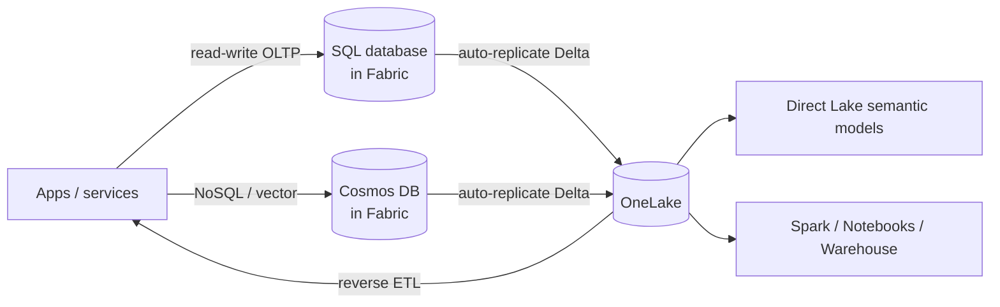

# Databases in Fabric Best Practices

Based on [Databases in Fabric](https://learn.microsoft.com/en-us/fabric/database/) and the [data store decision guide](https://learn.microsoft.com/en-us/fabric/fundamentals/decision-guide-data-store)

## Overview

The **Database** workload brings **operational (OLTP) databases** natively into Fabric, sitting alongside the analytical stores (Warehouse, Lakehouse, Eventhouse). Two options:

| Store | Type | Engine | Best for |
|-------|------|--------|----------|
| **[SQL database in Fabric](https://learn.microsoft.com/en-us/fabric/database/sql/overview)** | Relational OLTP | Same engine as Azure SQL Database | The home in Fabric for transactional apps and operational data |
| **[Fabric HorizonDB (preview)](https://learn.microsoft.com/en-us/fabric/database/horizondb/overview)** | Relational OLTP | PostgreSQL | Evaluate PostgreSQL-compatible applications and OneLake integration; only the database creator can connect during preview |
| **[Cosmos DB in Fabric](https://learn.microsoft.com/en-us/fabric/database/cosmos-db/overview)** | NoSQL | Same engine as Azure Cosmos DB for NoSQL | AI apps, semi-structured/evolving data, vector & hybrid search |

**The key architectural value: operational data lands in OneLake automatically.** Both Fabric-native databases **auto-replicate to OneLake in open Delta/Parquet format in near real time** — no ETL and no separate copy pipeline. For external operational databases, use Fabric [Mirroring](mirroring.md) where supported, and reserve Data Factory ingestion for sources that can't replicate or mirror cleanly.

## Choosing the right data store

All Fabric stores expose data in OneLake in open format by default — choose by **workload**, not by storage:

| Ideal use case | Store |
|----------------|-------|
| Operational transactional (OLTP) app | **SQL database in Fabric** |
| AI, NoSQL, vector / hybrid search | **Cosmos DB in Fabric** |
| Streaming events, high-granularity interactive analytics | Eventhouse ([RTI](real-time-intelligence.md)) |
| Enterprise data warehouse, SQL BI, OLAP, full SQL transactions | [Data Warehouse](https://learn.microsoft.com/en-us/fabric/data-warehouse/data-warehousing) |
| Big data / ML, un/semi/structured, data engineering | Lakehouse ([Medallion](medallion-architecture.md)) |

> **Rule of thumb:** use a **Database** for the *write* path (operational systems of record) and a **Warehouse/Lakehouse** for the curated *read* path (analytics). Let OneLake auto-replication bridge them instead of hand-built pipelines.

## Best practices

### Placement & architecture
- ✅ **Use SQL database in Fabric for OLTP** — transactional apps, operational systems of record — not the Warehouse or Lakehouse, which are analytical.
- ✅ **Use Cosmos DB for NoSQL / AI** — semi-structured data, evolving schemas, and built-in **vector, full-text, and hybrid (RRF) search** for RAG apps.
- ✅ **Pair them** — relational (SQL) + semi-structured (Cosmos) under one Fabric platform, both landing in OneLake.
- ✅ **Consume the OneLake replica for analytics** — build **[Direct Lake](direct-lake.md)** semantic models on the auto-replicated Delta tables; don't run BI DirectQuery against the live OLTP database.

### Ingestion & serving patterns
- ✅ **Skip custom mirroring/ETL for Fabric-native databases** — replication to OneLake is automatic and near real time. See [SQL DB mirroring/replication](https://learn.microsoft.com/en-us/fabric/database/sql/mirroring-overview) and [Cosmos DB mirror to OneLake](https://learn.microsoft.com/en-us/fabric/database/cosmos-db/mirror-onelake).
- ✅ **Use Mirroring or open mirroring for supported external operational sources** — let Fabric continuously replicate them into OneLake instead of building bespoke CDC pipelines. See [Mirroring best practices](mirroring.md).
- ✅ **Use Copy job/pipelines for non-mirrorable sources** — APIs, flat files, custom feeds, or sources that need mapping/transformation at ingest still belong in Data Factory.
- ✅ **Use [reverse ETL](https://learn.microsoft.com/en-us/fabric/database/sql/use-case-reverse-etl)** to serve curated Gold-layer OneLake data back into an operational database for low-latency app access.
- ✅ **Consider [translytical apps](https://learn.microsoft.com/en-us/fabric/database/sql/use-case-translytical-applications)** where transactional and analytical needs converge on one platform.

### Operations & security
- ✅ **Lean on intelligent defaults** — SQL database enables automatic index creation and auto-tuning by default; avoid premature manual tuning.
- ✅ **Govern with Purview and Entra ID** — apply protection/DLP policies, auditing, and least-privilege authorization. See [SQL DB security overview](https://learn.microsoft.com/en-us/fabric/database/sql/security-overview) and the repo [security best practices](../security/best-practices.md).
- ✅ **Use Copilot** for T-SQL authoring and productivity in [SQL database](https://learn.microsoft.com/en-us/fabric/database/sql/copilot).
- ✅ **Use Database Hub for estate-level observability** — monitor Azure, Fabric, on-premises, and multicloud database resources from the Fabric portal, then prioritize security, performance, and optimization findings without granting new data access.
- ✅ **Keep vector workloads close to operational data when appropriate** — SQL database in Fabric and Azure SQL vector indexes can support AI app patterns without a separate vector store, but keep analytics on the OneLake replica.

### Fit with the wider estate
- ✅ **Feed the Medallion pipeline** — treat the OneLake replica as a Bronze source for conforming/curating downstream, rather than reporting directly off raw operational tables.
- ✅ **Ground agents on operational data** — the OneLake replica is a governed source for data agents and Fabric IQ. See [data architecture for agents](../fabric-data-agents/data-architecture-for-agents.md).
- ✅ **A "bring operational databases into OneLake" solution play motion** — use it to identify operational database estates that can be mirrored into OneLake.

### Platform update: Database Hub and agentic database operations

Database Hub is generally available for discovering and monitoring supported resources across Azure, Fabric, on-premises, and supported multicloud environments. Database Agents remains in preview. Database Hub does not currently support Cosmos DB in Fabric, mirrored databases in Fabric, or Fabric Data Warehouse. Use it for estate visibility and triage, not as a replacement for source-system ownership.

Agentic database skills, Database Hub agent skills, SSMS Agent Mode, and Data API Builder MCP/vector/JSON improvements are useful accelerators for database engineering. Keep the same guardrails used elsewhere in Fabric: least privilege, explicit approval for generated DDL/DML, source-controlled schema changes, and validation against the target database.

## Anti-patterns

- 🚫 **Using a Warehouse or Lakehouse as an OLTP store** — they're analytical engines; single-row transactional writes belong in SQL database in Fabric.
- 🚫 **Building custom pipelines to copy operational data into OneLake when replication/mirroring exists** — hand-rolled ETL adds latency, cost, and drift.
- 🚫 **Using SQL database in Fabric as an enterprise data warehouse** — for OLAP/BI at scale and full DW semantics, use Data Warehouse and curate through Medallion.
- 🚫 **DirectQuery BI against the live operational database** — report off the OneLake Delta replica with Direct Lake to avoid loading the OLTP system.
- 🚫 **Storing semi-structured/vector data in a relational schema** — use Cosmos DB's NoSQL model and native vector/hybrid search instead of forcing JSON into rigid tables.

## References

- [Databases in Fabric documentation](https://learn.microsoft.com/en-us/fabric/database/)
- [SQL database in Fabric overview](https://learn.microsoft.com/en-us/fabric/database/sql/overview)
- [Cosmos DB in Fabric overview](https://learn.microsoft.com/en-us/fabric/database/cosmos-db/overview)
- [Choose a data store (decision guide)](https://learn.microsoft.com/en-us/fabric/fundamentals/decision-guide-data-store)
- [Mirroring in Fabric](https://learn.microsoft.com/en-us/fabric/mirroring/overview)
- [SQL database mirroring / replication](https://learn.microsoft.com/en-us/fabric/database/sql/mirroring-overview)
- [Cosmos DB mirror to OneLake](https://learn.microsoft.com/en-us/fabric/database/cosmos-db/mirror-onelake)
- [Reverse ETL with SQL database](https://learn.microsoft.com/en-us/fabric/database/sql/use-case-reverse-etl)
- [Translytical applications](https://learn.microsoft.com/en-us/fabric/database/sql/use-case-translytical-applications)
- [SQL database security overview](https://learn.microsoft.com/en-us/fabric/database/sql/security-overview)
- [Data Warehouse overview](https://learn.microsoft.com/en-us/fabric/data-warehouse/data-warehousing)
- [Database Hub overview](https://learn.microsoft.com/en-us/fabric/database/hub/overview)
- [Monitor PostgreSQL in Database Hub](https://learn.microsoft.com/en-us/fabric/database/hub/monitor-postgresql)
- [What's new across Microsoft SQL at SQLCon/FabCon Europe 2026](https://devblogs.microsoft.com/azure-sql/whats-new-across-microsoft-sql-at-sqlcon-fabcon-europe-2026/)
