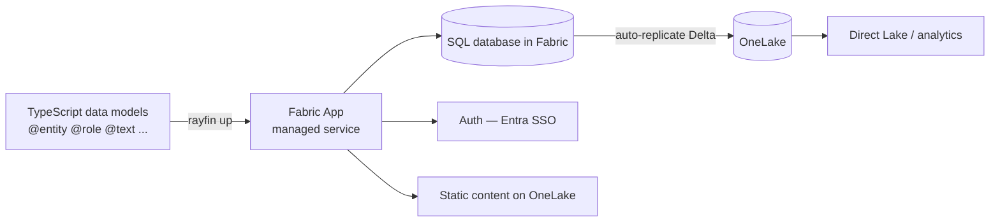

# Fabric Apps Best Practices

Based on [What is Fabric Apps?](https://learn.microsoft.com/en-us/fabric/apps/overview)

> **Generally available:** Fabric Apps and Rayfin reached general availability in November 2026. Verify [region availability](https://learn.microsoft.com/en-us/fabric/admin/region-availability), tenant settings, capacity, and support for the specific services your app uses before deploying to production.

## Overview

Fabric Apps lets developers build **data-driven, full-stack applications natively on Fabric** using a unified TypeScript workflow (the **Rayfin SDK**). You define data models as TypeScript classes with decorators, and Fabric Apps automatically generates the database schema, a GraphQL API, row-level authorization, a type-safe client, authentication, and static hosting — no backend boilerplate.

It turns governed Fabric data into an application backend that lives *inside* the platform, sharing OneLake, identity, capacity, and lifecycle with the rest of your estate.

## How it works

A Fabric app runs as a **managed service** — Fabric handles hosting, networking, and scaling. On deploy (`rayfin up`), it provisions child services from your `rayfin.yml`:

| Child service | Provides | Notes |
|---------------|----------|-------|
| **SQL database in Fabric** | Managed relational store; schema applied from your TypeScript decorators | **Read-only in the portal** — schema changes must come from code |
| **Authentication** | Fabric-brokered **Microsoft Entra ID SSO** | Fabric SSO exclusively; no other providers after deployment |
| **Static Content** | Hosted frontend (HTML/CSS/JS) | Choose protected or anonymous access for static files; this is separate from backend data authorization |

A single backend endpoint exposes `/api/graphql` (data API), `/auth` (authentication), and `/storage` (files).

## When to use Fabric Apps

Ideal for:
- **Rapid prototyping** — idea to live, authenticated URL in minutes
- **Internal tools & dashboards** — admin interfaces without backend boilerplate
- **Data exploration & visualization** — query Fabric data via GraphQL in a custom frontend
- **AI & agent applications** — structured backend and persistent state for agents

Consider other options when you need:
- Complex multi-step transactions or stored procedures
- Custom authentication providers (Fabric Apps uses Entra SSO only)
- A full enterprise application platform with bespoke infrastructure

## Best practices

### Data model & schema
- ✅ **Treat code as the single source of truth for schema.** Apply changes via `npx rayfin up db apply` — never edit the child SQL database directly; direct changes cause schema conflicts that break the app.
- ✅ **Enforce authorization in the model** with `@role(...)` policies so row-level rules are generated and consistent, not bolted on in the frontend.
- ✅ **Validate at the edge** — use the type-safe client so queries/mutations are checked during development.

### Identity & sharing
- ✅ **Rely on Fabric SSO (Entra ID)** for authentication; design around a single, governed identity rather than custom auth.
- ✅ **Grant least-privilege item permissions** — `Run and interact` for users, `Edit` only for developers who deploy, `Reshare` sparingly (requires workspace admin). Remember item-level permissions are **not** superseded by workspace roles.

### Data & platform fit
- ✅ **Build on governed Fabric data** — the backing [SQL database in Fabric](databases-in-fabric.md) auto-replicates to OneLake as Delta, so app data is analytics-ready via [Direct Lake](direct-lake.md) with no extra ETL.
- ✅ **Use apps as an agent/AI backend** — persistent, permissioned state for [data agents](../fabric-data-agents/data-agent-best-practices.md) grounded on the same estate.
- ✅ **Right-size capacity** — Fabric Apps consume capacity units from the assigned capacity; monitor and plan capacity like any other workload.

### Lifecycle
- ✅ **Choose where the backend runs** — the default `npx rayfin dev` workflow can provision or reuse a Fabric backend while running the frontend locally. Use [Rayfin Local](https://github.com/microsoft/rayfin-local) to run both locally without provisioning a Fabric workspace. Test connectors, identity, and permissions in Fabric before production; connectors that access Fabric still require connectivity and credentials.
- ✅ **Manage the tenant prerequisite** — a tenant admin must enable the Fabric Apps workload, and the workspace must have Fabric capacity assigned.
- ✅ **Integrate with source control and pipelines** — keep the project in Git and align deployments with your [CI/CD practices](ci-cd-deployment.md).

## Anti-patterns

- 🚫 **Editing the child SQL database schema in the portal** — always change schema in code (`rayfin/data`) and deploy; direct edits break the app.
- 🚫 **Reimplementing authentication** — Fabric Apps is Entra SSO only; don't try to bolt on external identity providers.
- 🚫 **Building analytical/reporting workloads into the app database** — report off the OneLake Delta replica with Direct Lake, not the operational app store.
- 🚫 **Using Fabric Apps for heavy transactional systems** — workloads needing complex multi-step transactions or stored procedures belong in a purpose-built database tier.
- 🚫 **Over-granting `Edit`/`Reshare`** — keep deploy and resharing rights with a small set of owners.

## Related solutions

- [Microsoft Rayfin](../solutions/fabric-apps/repos/microsoft-rayfin.md) - public SDK, CLI, and template entry points
- [Rayfin Onboarding 2026](../solutions/fabric-apps/repos/rayfin-onboarding-2026.md) - a public work-order app lab with setup caveats

## References

- [What is Fabric Apps? (overview)](https://learn.microsoft.com/en-us/fabric/apps/overview)
- [Rayfin GitHub repository](https://github.com/microsoft/rayfin)
- [Rayfin SDK overview](https://learn.microsoft.com/en-us/javascript/api/fabric-apps-sdk-javascript/rayfin-overview)
- [Rayfin CLI reference](https://learn.microsoft.com/en-us/fabric/apps/cli-reference)
- [Create and deploy a Fabric app with the CLI](https://learn.microsoft.com/en-us/fabric/apps/create-app-with-cli)
- [Fabric Apps region availability](https://learn.microsoft.com/en-us/fabric/admin/region-availability)
- [Workspace roles](https://learn.microsoft.com/en-us/fabric/fundamentals/roles-workspaces)
- [SQL database in Fabric overview](https://learn.microsoft.com/en-us/fabric/database/sql/overview)
