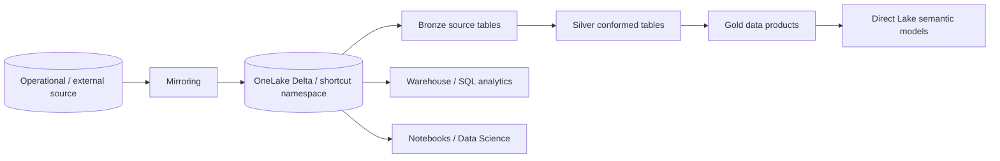

# Mirroring in Fabric Best Practices

Based on [Mirroring in Fabric](https://learn.microsoft.com/en-us/fabric/mirroring/overview) and the source-specific Microsoft Learn mirroring articles.

## Overview

Mirroring is the preferred pattern for bringing supported operational and external data sources into OneLake with low latency and minimal custom data movement. It turns existing databases, catalogs, and open Delta feeds into Fabric-accessible data products without building bespoke CDC pipelines for every source.

Use mirroring when the goal is to make source data available for analytics, AI, data engineering, and BI in OneLake while keeping source ownership and replication concerns clear.

## Mirroring patterns

| Pattern | What it does | Use when |
|---------|--------------|----------|
| **Database mirroring** | Replicates source tables and changes into OneLake-backed Delta tables | The source is a supported operational database such as Azure SQL Database, SQL Server, PostgreSQL, Snowflake, BigQuery, Oracle, SAP Datasphere, Cosmos DB, or Fabric SQL database |
| **Metadata mirroring** | Synchronizes catalog/schema/table metadata and reaches source data through OneLake shortcuts instead of copying data | The source already manages open data and Fabric should expose it through a governed OneLake namespace, such as mirrored Databricks catalog patterns |
| **Open mirroring** | Lets applications or partners land change data into a mirrored database landing zone using the open mirroring specification | A source is not natively supported but can publish changes in the required open format |

### Platform update: expanding the mirrored estate

Keep mirroring as the default first question for supported operational and external sources. Recent announcements expand the pattern in three useful directions:

- **Google BigQuery mirroring available/GA** — use it before designing bespoke BigQuery export/import pipelines.
- **Dynamics 365 Business Central integration** — selected Business Central tables can be brought into OneLake through mirroring with built-in monitoring and logs.
- **Catalog federation / metadata mirroring expansion** — AWS Glue Data Catalog and Google Lakehouse runtime catalog federation make more external open-table catalogs discoverable through OneLake without copying the underlying data.

Treat each source as its own contract: validate current region support, table/data-type limitations, identity model, latency expectations, and monitoring surfaces before committing to a customer architecture.

## Where mirroring fits

Mirroring is usually an **ingestion and unification** pattern, not the final business layer. Treat mirrored tables as source-aligned Bronze or externally governed data products, then conform and curate them where analytics require business rules, quality controls, or star schemas.

## Best practices

### Source selection
- ✅ **Prefer mirroring over custom CDC pipelines for supported sources** — use the managed replication path before designing hand-built copy jobs, triggers, or notebooks.
- ✅ **Choose the mirroring type deliberately** — use database mirroring for replicated table data, metadata mirroring for catalog/shortcut exposure, and open mirroring when a source can publish changes into Fabric's open pattern.
- ✅ **Confirm source limitations before committing** — each source has specific requirements, unsupported data types, security considerations, and replication limits.
- ✅ **Use Data Factory for non-mirrorable sources** — APIs, files, and sources that need mapping or transformation at ingest still belong in [Data Factory](data-factory.md).

### Architecture and modeling
- ✅ **Land mirrored data in OneLake, then curate** — use mirrored tables as source-aligned inputs to Medallion processing rather than exposing every raw table directly to consumers.
- ✅ **Use cross-database queries intentionally** — mirrored databases, warehouses, and SQL analytics endpoints can participate in T-SQL patterns, but curated models should still have clear ownership and performance expectations.
- ✅ **Pair with shortcuts for zero-copy distribution** — when metadata mirroring or sharing exposes data without duplication, apply the same security review used for [OneLake shortcuts](onelake-shortcuts.md).
- ✅ **Document freshness expectations** — mirroring is near real time, not instantaneous. Replication latency depends on source change volume, region, network, gateway, and source engine behavior.

### Security and operations
- ✅ **Secure the source connection** — validate network path, credential ownership, gateway requirements, and least-privilege source permissions before enabling mirroring.
- ✅ **Review mirrored database sharing** — sharing can grant access to the mirrored database and SQL analytics endpoint without granting workspace access.
- ✅ **Monitor replication health** — treat replication lag, source schema changes, and failed tables as operational signals with owners and runbooks.
- ✅ **Separate replication from transformation** — keep mirroring simple; apply business transformations downstream where they can be versioned, tested, and promoted.
- ✅ **Track cost boundaries** — mirroring can include capacity-based free storage limits, but downstream processing, BI, and transformations still consume capacity and storage.

## Anti-patterns

- 🚫 **Building custom CDC when mirroring exists** — this creates avoidable latency, cost, drift, and operational burden.
- 🚫 **Treating mirrored data as fully conformed Gold data** — source-aligned replication does not replace business rules, quality checks, or dimensional modeling.
- 🚫 **Ignoring source-specific limitations** — one source's mirroring behavior does not guarantee another source supports the same tables, data types, keys, latency, or security model.
- 🚫 **Using mirroring as a transformation engine** — mirroring replicates and exposes data; it should not carry complex business logic.
- 🚫 **Sharing mirrored data without access review** — mirrored databases can expose sensitive source data broadly if workspace, item, SQL, and shortcut permissions are not designed intentionally.

## References

- [Mirroring in Fabric](https://learn.microsoft.com/en-us/fabric/mirroring/overview)
- [Azure SQL Database mirroring](https://learn.microsoft.com/en-us/fabric/mirroring/azure-sql-database)
- [SQL Server mirroring](https://learn.microsoft.com/en-us/fabric/mirroring/sql-server)
- [Azure Cosmos DB mirroring](https://learn.microsoft.com/en-us/fabric/mirroring/azure-cosmos-db)
- [Snowflake mirroring](https://learn.microsoft.com/en-us/fabric/mirroring/snowflake)
- [Google BigQuery mirroring](https://learn.microsoft.com/en-us/fabric/mirroring/google-bigquery)
- [Azure Databricks metadata mirroring](https://learn.microsoft.com/en-us/fabric/mirroring/azure-databricks)
- [AWS Glue catalog mirroring](https://learn.microsoft.com/en-us/fabric/mirroring/catalog-mirroring/aws-glue)
- [Google Lakehouse runtime catalog mirroring](https://learn.microsoft.com/en-us/fabric/mirroring/catalog-mirroring/google-lakehouse-runtime)
- [Open mirroring](https://learn.microsoft.com/en-us/fabric/mirroring/open-mirroring)
- [Dynamics 365 Business Central integration with Fabric](https://learn.microsoft.com/en-us/dynamics365/business-central/admin-fabric)
- [Troubleshoot mirroring](https://learn.microsoft.com/en-us/fabric/mirroring/troubleshooting)
