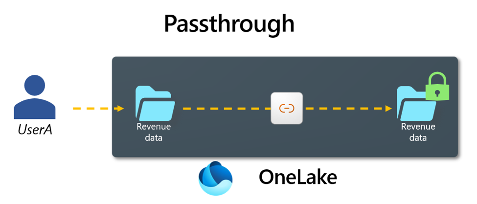
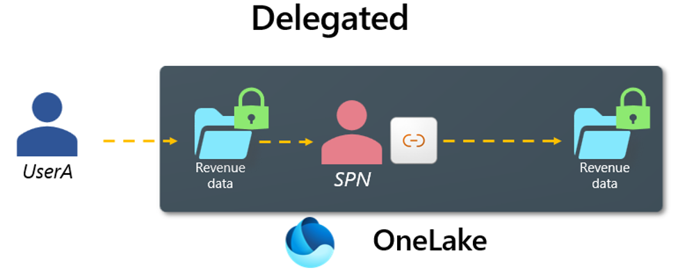
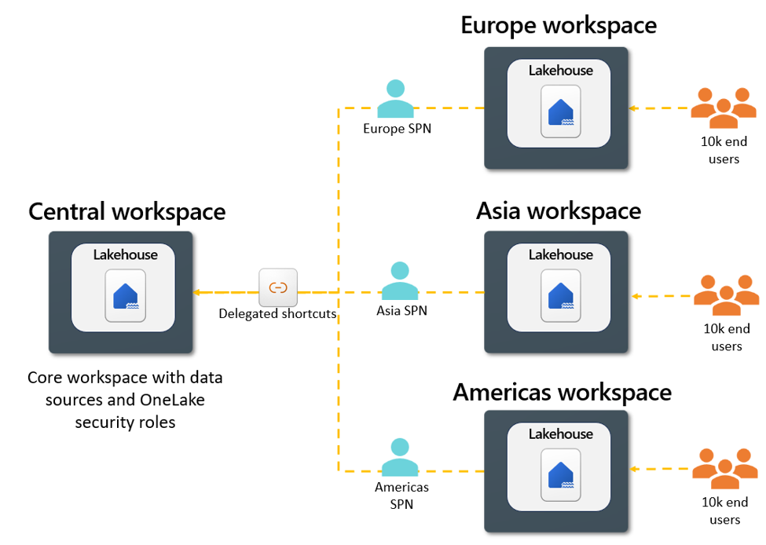

# Best Practice: OneLake Shortcuts (Minimize Data Movement)

Based on the [OneLake documentation](https://learn.microsoft.com/en-us/fabric/onelake/) — covering OneLake fundamentals, shortcuts, security, open access, integrations, and governance.

## Overview

OneLake is the single, unified data lake for your entire organization — automatically provisioned with every Fabric tenant. Shortcuts are virtual references (like symbolic links) that point to data in other storage locations without physically copying it. They make OneLake the single namespace for all analytics data across domains, clouds, and accounts.

## OneLake fundamentals

- **One data lake per tenant** — Cannot create multiple OneLakes; cannot delete it
- **Governed by default** — Tenant-level policies for security, compliance, and data management apply to all data
- **Open format** — Fabric-managed tabular data uses open table formats in OneLake, with Delta as the default serving format and shortcut/interop patterns such as Iceberg where appropriate; compatible with ADLS Gen2 APIs and SDKs
- **Multi-engine** — Same data accessible by Spark, T-SQL, KQL, Analysis Services (Direct Lake), and external tools (Azure Databricks, Snowflake, Azure Synapse)
- **Built-in protection** — Soft delete (7-day recovery), zone-redundant storage, optional BCDR
- **OneLake file explorer** — Windows app for browsing/uploading/downloading OneLake data like OneDrive

## Shortcuts: How they work

Shortcuts appear as folders in OneLake. Any workload or service that accesses OneLake can use them transparently — they don't require per-engine configuration.

| Concept | Description |
|---------|-------------|
| **Shortcut path** | Where the shortcut appears (the virtual folder) |
| **Target path** | The actual data location the shortcut points to |
| **Behavior** | Independent object — deleting a shortcut doesn't affect target |
| **Breaking** | If target is moved/renamed/deleted, shortcut breaks |

## Supported sources

### Internal (within OneLake)

- Lakehouses, Warehouses, KQL databases
- Mirrored databases, SQL databases
- Semantic models, Mirrored Databricks Catalogs
- Cross-workspace and cross-item (e.g., lakehouse shortcut → warehouse data)

### External

| Source | Auth method |
|--------|-------------|
| Azure Data Lake Storage Gen2 | Cloud connection (service principal, account key, or SAS) |
| Azure Blob Storage | Cloud connection |
| Amazon S3 | Cloud connection (IAM role or access key) |
| Amazon S3-compatible | Cloud connection |
| Google Cloud Storage | Cloud connection |
| Dataverse | Cloud connection (organizational account) |
| OneDrive / SharePoint | Organizational account |
| Iceberg tables | Cloud connection |
| On-premises (via data gateway) | Gateway + cloud connection |

## When to use shortcuts

| Scenario | Use Shortcut? |
|----------|:---:|
| Accessing data from another Fabric workspace | ✅ |
| Reading from ADLS Gen2 without copying | ✅ |
| Connecting to AWS S3 or GCS data | ✅ |
| Referencing Dataverse tables | ✅ |
| Cross-domain data mesh (virtual data products) | ✅ |
| Sharing gold-layer tables with consumers in other workspaces | ✅ |
| Exposing warehouse tables to a lakehouse consumer | ✅ |
| Iceberg table interop (e.g., Snowflake) | ✅ |
| Data requiring format conversion (CSV → Delta) | ❌ Ingest + convert |
| Data requiring heavy transformation before use | ❌ Ingest to Bronze |
| High-write workloads on external targets | ❌ Copy locally |

## Where to create shortcuts

### In a Lakehouse

| Location | Rules | Use for |
|----------|-------|---------|
| **Tables** folder | Top-level only (no subdirectories); no spaces in names; can point to single table or schema (parent folder) | Delta tables recognized automatically |
| **Files** folder | Any level of folder hierarchy | Unstructured/semi-structured data in any format |

### In a KQL Database

- Shortcuts appear in the **Shortcuts** folder
- Queried using `external_table('MyShortcut')` in KQL

## Shortcut transformations

Shortcuts now support inline transformations:

| Type | Description |
|------|-------------|
| **Structured data transforms** | Apply schema projections, filters, and type conversions on shortcut data |
| **AI transforms** | Apply AI-based extraction on unstructured data (images, PDFs) via shortcuts |

> **Reference**: [Transform structured data](https://learn.microsoft.com/en-us/fabric/onelake/shortcuts/transformations) · [Transform with AI](https://learn.microsoft.com/en-us/fabric/onelake/shortcuts/transformations-ai)

## Engine access patterns

| Engine | How to access shortcut data |
|--------|---------------------------|
| **Apache Spark** | `spark.read.format("delta").load("Tables/MyShortcut")` or Spark SQL |
| **T-SQL** | `SELECT * FROM [MyLakehouse].[dbo].[MyShortcut]` via SQL analytics endpoint |
| **KQL** | `external_table('MyShortcut') \| take 100` |
| **Analysis Services** | Direct Lake mode reads shortcut data transparently |
| **External tools** | OneLake API: `https://onelake.dfs.fabric.microsoft.com/...` |

## Implementation guidelines

1. **One copy, many shortcuts** — Store data once in OneLake; create shortcuts for every team that needs access
2. **Use shortcuts in Bronze** — Point to external landing zones; transform into Silver within your own Lakehouse
3. **Use internal shortcuts for cross-domain sharing** — Share gold-layer tables across workspaces without duplication
4. **Enable caching for cross-cloud shortcuts** — Reduces egress costs for S3, GCS, and on-premises sources (1–28 day retention)
5. **Monitor shortcut latency** — External shortcuts have network latency; cache or co-locate for performance-sensitive queries
6. **Use cloud connections for external sources** — OneLake manages credentials centrally; use `manage-shortcut-connections` to audit
7. **Place shortcuts in Tables (not Files) for Delta data** — Enables automatic table discovery and SQL/Spark access
8. **No spaces in shortcut names** — Delta format doesn't support table names with spaces
9. **Use schema-level shortcuts** — Point to a parent folder containing multiple tables to onboard an entire schema at once
10. **Leverage OneLake table APIs** — For programmatic access to Delta and Iceberg tables via REST

## Security considerations

| Scenario | Authorization behavior |
|----------|----------------------|
| Internal shortcut, Spark/SQL User Identity mode | Calling user's identity authorizes access to target |
| Internal shortcut, Direct Lake on SQL or delegated T-SQL | Item owner's identity is used (not calling user) |
| External shortcut (ADLS, S3, GCS) | Cloud connection credentials authorize access |
| Cross-workspace | User must have permissions in both source workspace and target |

**Best practices for shortcut security**:
- Choose the engine path deliberately: Direct Lake on OneLake enforces OneLake access directly, while Direct Lake on SQL/delegated T-SQL can use the item owner's identity to reach the target and then apply OneLake roles
- Configure **OneLake data access roles** (table, folder, column, row-level security) for granular access control where the item and engine support them
- Use **resource instance rules** for trusted inbound access from Azure services
- Manage **inbound/outbound access** policies for network-restricted scenarios
- Encrypt sensitive data with **customer-managed keys (CMK)** at the workspace level
- Validate managed private endpoint and Private Link support for the shortcut type and pipeline/workload path; support is not identical across all items

> **Reference**: [Shortcut security](https://learn.microsoft.com/en-us/fabric/onelake/onelake-shortcut-security) · [Best practices for securing data in OneLake](https://learn.microsoft.com/en-us/fabric/onelake/security/best-practices-secure-data-in-onelake)

## Securing zero-copy distribution: passthrough vs. delegated shortcuts

Shortcuts are the foundation for **zero-copy distribution** — presenting data where teams need it while it stays in its original location. How OneLake security combines with a shortcut depends on the shortcut's authentication mode.

| Mode | How access is evaluated | Who manages permissions | Best for |
|------|------------------------|-------------------------|----------|
| **Passthrough** (default) | The calling user is "passed" to the target; permissions on the shortcut path and target path combine and the **most restrictive** result applies. You *cannot* set OneLake security on the shortcut path. | The data owner, at the target | Collaborative data engineering; keeping security identical wherever the data is read |
| **Delegated** | Access uses an **intermediate identity** (service principal, workspace identity, or — for external sources — an account key/system identity) attached to the shortcut. End-user access is the **intersection** of that identity's access and the OneLake security roles set on the shortcut path — users can never get *more* than the delegated identity. | Delegated to the shortcut/data-product owner | Broad governed distribution, scale-out access management, and cross-tenant sharing |

*Passthrough shortcuts evaluate permissions on the target.*

*Delegated shortcuts combine security across an intermediate identity via intersection.*

**Use passthrough when:**
- You want security to be consistent regardless of where the data is accessed
- The data owner wants to manage all access centrally at the source (default, cleanest model)

**Use delegated when:**
- You don't want to give end users direct access to the target item
- Managing every end user on the target data becomes a scale concern (e.g., delegate per-region access to team owners via a service principal)
- You need to share data with **another Fabric tenant**, or reach **external** sources such as AWS S3 or GCS (external shortcuts always operate as delegated)

*This illustrates delegated access by region. The user counts are example sizes, not a capacity or performance guarantee.*

> **Design guidance:** Prefer **passthrough** for source-managed team collaboration. Reach for **delegated** shortcuts when publishing through curated serving layers — be explicit about where delegated mode is in play, document the trust boundary, and design security reviews around the actual engine path users take. Note that delegated OneLake shortcuts are a newer capability (rolled out alongside SharePoint/OneDrive shortcuts); confirm current availability for your tenant.

Delegated shortcut limits matter for secure designs: column-level security can apply on producer and consumer sides, row-level security is supported on the producer side but not the consumer side, and Spark/API access to external shortcuts also requires read permission on the item containing the shortcut.

> **Reference**: [Secure and manage OneLake shortcuts](https://learn.microsoft.com/en-us/fabric/onelake/onelake-shortcut-security) · [OneLake security access control model — Shortcuts](https://learn.microsoft.com/en-us/fabric/onelake/security/data-access-control-model) · Diagrams from [Securing zero-copy distribution patterns with OneLake security](https://community.fabric.microsoft.com/t5/Fabric-Updates-Blog/Securing-zero-copy-distribution-patterns-with-OneLake-security/ba-p/5227853) (Microsoft Fabric Updates Blog)

## Caching (cross-cloud egress reduction)

| Setting | Details |
|---------|---------|
| Supported sources | GCS, S3, S3-compatible, on-premises gateway |
| Retention | 1–28 days (configurable per workspace) |
| File size limit | Individual files > 1 GB are not cached |
| Reset | Can clear cache at any time from workspace settings |
| Refresh | If remote file is newer than cached version, OneLake fetches updated version |

Enable in: **Workspace Settings → OneLake → Cache → On**

## Storage tiers and lifecycle management

- OneLake supports **storage tiers** for cost optimization (hot vs. cool/archive)
- Configure **lifecycle management policies** to automatically move or delete data based on age
- Use **OneLake diagnostics** to monitor storage consumption and access patterns
- Track item sizes with the `Get-OneLakeItemSize` API

> **Reference**: [Storage tiers](https://learn.microsoft.com/en-us/fabric/onelake/onelake-storage-tiers) · [Lifecycle management](https://learn.microsoft.com/en-us/fabric/onelake/onelake-lifecycle-management)

## Integrations with external services

| Service | Integration |
|---------|-------------|
| **Azure Databricks** | OneLake shortcuts + Unity Catalog federation |
| **Azure Synapse Analytics** | Direct access via ADLS Gen2 APIs |
| **Snowflake** | Iceberg table shortcuts for bidirectional interop |
| **Azure Storage Explorer** | Browse/manage OneLake files directly |
| **AzCopy** | Bulk data transfers to/from OneLake |
| **PowerShell** | Scripted OneLake management |
| **AI agents (MCP)** | Local MCP server for AI agent access to OneLake data |
| **Microsoft Foundry** | Knowledge integration with OneLake files |

## Platform update: OneLake as an open AI data foundation

Recent OneLake announcements expand the same zero-copy pattern beyond analytics into agents, apps, and external engines. Fold these into architecture decisions deliberately:

| Capability | Architecture use | Watch-out |
|------------|------------------|-----------|
| **IQ sharing** | Share governed data and business context such as files, Markdown agent instructions, and RDF ontologies across teams or partners | Preview/announced capability; validate current support for Fabric IQ ontologies and semantic models before designing around them |
| **Salesforce Data 360 shortcuts** | Expose Salesforce-governed data in OneLake for Fabric SQL, notebooks, Power BI, ontologies, and data agents without duplicate pipelines | Salesforce admins still control what is shared; review both Salesforce controls and OneLake security |
| **lakeFS version-aware shortcuts** | Reference latest branch data or immutable commits for reproducible reporting, experiments, and audits | Confirm branch/commit semantics with data owners so reports don't silently mix versions |
| **OneLake Table Read API** | Let AI agents and applications read authorized Delta/Iceberg table rows directly as Apache Arrow without going through SQL | Preview; requires Entra authentication and enforces OneLake table, row, and column security for the calling identity |
| **Catalog Search REST API** | Let apps and agents discover accessible OneLake catalog entries across workspaces before using item-specific APIs or MCP tools | Preview; returns metadata only and is permission-scoped to the calling identity |
| **OneLake catalog in Excel and Foundry** | Let business users and AI builders discover endorsed data where they already work | Catalog metadata quality, endorsements, labels, and descriptions now affect downstream AI and Excel experiences |
| **OneLake file explorer cloud expansion** | Extend desktop-style OneLake browsing to more regulated cloud environments where supported | Validate tenant cloud, sync/client version, and security policy; this improves access experience but doesn't change the OneLake-first architecture |
| **On-demand OneLake billing / zero-provisioned Fabric** | Lower the barrier to using OneLake as a shared data foundation without always-running Fabric capacity | Preview/announced; keep storage, transaction, and scan costs separate from capacity forecasts |

> **Design guidance:** These features strengthen the repo's OneLake-first stance. Use them to reduce data movement and duplicated context, but keep governance, owner approval, and preview status visible in design reviews.

## Anti-patterns to avoid

| Anti-pattern | Impact | Fix |
|---|---|---|
| **Copying data between workspaces** | Storage cost, drift, governance gaps | Use internal shortcuts |
| **Multiple teams ingesting same source** | Redundant pipelines, inconsistent data | One team ingests; others use shortcuts |
| **Shortcut to unstable external paths** | Broken shortcuts when targets move | Use stable container/path conventions |
| **Ignoring caching for cross-cloud** | High egress costs (S3, GCS) | Enable workspace-level caching |
| **Shortcuts in Tables folder subdirectories** | Not supported; breaks discovery | Only create at top level of Tables |
| **Spaces in shortcut names** | Delta tables not recognized | Use underscores or hyphens |
| **Using Direct Lake on SQL with shortcuts** | Owner identity passed instead of user | Use Direct Lake on OneLake mode |
| **No access control on shortcut targets** | Unintended data exposure across teams | Configure OneLake security roles |
| **Bypassing OneLake entirely** | Lose governance, multi-engine access, lineage | Always land data in OneLake |
| **Replacing mirroring with shortcuts for change replication** | Shortcuts expose data in place; they don't provide database replication semantics | Use [Mirroring](mirroring.md) for supported operational replication scenarios |

## Anti-pattern this prevents

- [Bypassing OneLake](../anti-patterns/bypassing-onelake.md) — Multiple copies, governance gaps, increased cost

## References

- [OneLake documentation hub](https://learn.microsoft.com/en-us/fabric/onelake/)
- [What is OneLake?](https://learn.microsoft.com/en-us/fabric/onelake/onelake-overview)
- [What are shortcuts?](https://learn.microsoft.com/en-us/fabric/onelake/onelake-shortcuts)
- [OneLake catalog overview](https://learn.microsoft.com/en-us/fabric/governance/onelake-catalog-overview)
- [Catalog Search REST API](https://learn.microsoft.com/en-us/rest/api/fabric/core/catalog/search)
- [Shortcut security](https://learn.microsoft.com/en-us/fabric/onelake/onelake-shortcut-security)
- [Best practices for securing data in OneLake](https://learn.microsoft.com/en-us/fabric/onelake/security/best-practices-secure-data-in-onelake)
- [Create an internal shortcut](https://learn.microsoft.com/en-us/fabric/onelake/shortcuts/create-onelake-shortcut)
- [OneLake table APIs](https://learn.microsoft.com/en-us/fabric/onelake/table-apis/table-apis-overview)
- [OneLake consumption and billing](https://learn.microsoft.com/en-us/fabric/onelake/onelake-consumption)
- [Storage tiers](https://learn.microsoft.com/en-us/fabric/onelake/onelake-storage-tiers)
- [Lifecycle management](https://learn.microsoft.com/en-us/fabric/onelake/onelake-lifecycle-management)
- [OneLake file explorer](https://learn.microsoft.com/en-us/fabric/onelake/onelake-file-explorer)
- [Disaster recovery](https://learn.microsoft.com/en-us/fabric/onelake/onelake-disaster-recovery)
- [Soft delete recovery](https://learn.microsoft.com/en-us/fabric/onelake/soft-delete)
- [OneLake and Salesforce Data 360 connector](https://developer.salesforce.com/docs/data/data-cloud-int/guide/c360-a-microsoftfabriconelake-connector.html)
- [OneLake data in Microsoft Foundry knowledge](https://learn.microsoft.com/en-us/fabric/onelake/onelake-foundry-knowledge)
- [FabCon and SQLCon Barcelona 2026: What's new in OneLake](https://aka.ms/OneLake-EU26)
