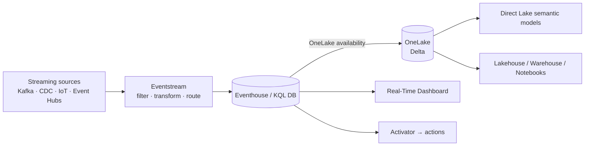

# Real-Time Intelligence (RTI) Best Practices

Based on [What is Real-Time Intelligence in Microsoft Fabric?](https://learn.microsoft.com/en-us/fabric/real-time-intelligence/overview)

## Overview

Real-Time Intelligence is Fabric's end-to-end workload for **data in motion** — event-driven scenarios where you respond to events as they happen, process continuously flowing data, or analyze logs at any volume. It's the right choice when you need solutions that **react to events**, not solutions that run on a schedule.

Typical scenarios: IoT and manufacturing telemetry, fraud and anomaly detection, operational/observability logs, geospatial tracking, Fabric capacity operation monitoring, and agent/AI telemetry and content-safety monitoring.

## Components

| Component | Role | When to use |
|-----------|------|-------------|
| **[Real-Time hub](real-time-hub.md)** | Central catalog of all data in motion (streams, Microsoft/CDC sources, Fabric & Blob events, business events) | Discover, add, and share streaming data org-wide |
| **[Capacity operation events](https://learn.microsoft.com/en-us/fabric/real-time-hub/create-streams-fabric-capacity-operation-events) (Preview)** | Fabric event source that emits one event per capacity-consuming operation, including CU consumption, duration, throttling delay, status, workspace, item, operation, and identity metadata | Monitor capacity activity in near real time and route high-signal events to Eventstream, Eventhouse, dashboards, or Activator |
| **[Eventstream](https://learn.microsoft.com/en-us/fabric/real-time-intelligence/event-streams/overview)** | No-code ingest, transform, and route streams | Collect from Kafka, CDC, Event Hubs, IoT Hub, Kinesis, GCP Pub/Sub, MQTT |
| **[Eventhouse / KQL database](https://learn.microsoft.com/en-us/fabric/real-time-intelligence/eventhouse)** | Analytics engine optimized for time-based events | Store and query streaming data with KQL or T-SQL |
| **[Real-Time Dashboards](https://learn.microsoft.com/en-us/fabric/real-time-intelligence/dashboard-real-time-create)** | Seconds-from-ingestion visualization (KQL, NL, Copilot) | Live operational monitoring |
| **[Activator](https://learn.microsoft.com/en-us/fabric/real-time-intelligence/data-activator/activator-introduction)** | Detect patterns/conditions and trigger actions | Alerts → email, pipelines, Spark, Dataflows, Power Automate |
| **Rules page in Real-Time hub** | Central management view for Activator rules across workspaces | Review, start/stop, inspect activity, and open rules without hunting across individual items |
| **[Operations agent](https://learn.microsoft.com/en-us/fabric/real-time-intelligence/operations-agent)** | AI-assisted operations over Eventhouse data | Ask operational questions and investigate live telemetry |

A typical flow: **Source → Eventstream (process) → Eventhouse (store/analyze) → Dashboard / Activator (visualize / act)**, with data agents able to reason over live and historical Eventhouse data.

## Where RTI fits in OneLake and Medallion

RTI is a first-class citizen of OneLake, not a side silo:

- **Streaming ingestion** feeds the [Medallion architecture](medallion-architecture.md) — Eventstream lands raw events; Eventhouse serves the real-time (hot) path while batch pipelines handle Bronze→Silver→Gold.
- **OneLake availability** creates a logical **Delta** copy of KQL data, queryable by [Direct Lake](direct-lake.md), Warehouse, Lakehouse, Notebooks, and the SQL endpoint — one copy, every engine.
- **Cross-workload serving**: the same Eventhouse data powers Real-Time Dashboards *and* Power BI Direct Lake models without duplication.

## Best practices

### Ingestion & processing
- ✅ **Push transformation upstream into Eventstream** — filter, cleanse, dedupe, and do windowed aggregations before landing, so Eventhouse stores query-ready data.
- ✅ **Use CDC connectors from the Real-Time hub** for operational databases (Azure SQL DB, Cosmos DB, PostgreSQL) instead of custom polling.
- ✅ **Use mirrored database change feed when mirroring already owns the source replication** — stream row-level changes from a supported mirrored database into Eventstream instead of building separate CDC infrastructure.
- ✅ **Use derived eventstreams** to share transformed streams rather than re-ingesting the same source multiple times.
- ✅ **Use schema-aware Eventstreams for evolving events** — bind producers and consumers to a shared schema contract when event shapes can vary or need quality enforcement.
- ✅ **Consider custom streaming connectors for nonstandard sources** — use them when built-in connectors don't cover a Kafka/open-source connector requirement, but validate preview/supportability before customer commitments.
- ✅ **Use managed private endpoints for secure streaming sources** — when Eventstream ingests from Azure Event Hubs or Azure IoT Hub with public access disabled, use the GA managed private endpoint path instead of opening the source to public network access.

### Eventhouse / KQL modeling
- ✅ **Let data organize by arrival time** — Eventhouse is optimized for time-based events; design tables and queries around time filters.
- ✅ **Set explicit [retention and caching policies](https://learn.microsoft.com/en-us/fabric/real-time-intelligence/data-policies)** — keep only the [hot cache](https://learn.microsoft.com/en-us/kusto/management/cache-policy) you query frequently; let older data age out or move to OneLake.
- ✅ **Use [update policies](https://learn.microsoft.com/en-us/kusto/management/update-policy)** to shape/enrich data at ingestion, and **[materialized views](https://learn.microsoft.com/en-us/fabric/real-time-intelligence/materialized-view)** for pre-aggregated hot queries.
- ✅ **Prefer native KQL** for time-series and log analytics; use the T-SQL endpoint for interoperability, not as the primary path.

### OneLake availability
- ✅ **Turn on OneLake availability** for KQL data that BI or other engines need, so Power BI uses **Direct Lake** on the Delta copy — no import, no DirectQuery.
- ✅ **Align retention expectations**: the KQL retention policy also governs the OneLake copy; data removed at end of retention is removed from OneLake too.
- ✅ **Plan for adaptive batching latency**: Eventhouse batches writes to OneLake for file health. The default delay can be up to 3 hours or until files are sufficiently sized; lowering it toward the 5-minute minimum improves freshness but can create many small files.
- ⚠️ **Know the constraints while enabled**: you can't rename tables, alter column types (add/drop is OK), apply row-level security, or delete/truncate/purge. Finalize schema and RLS strategy first.
- ⚠️ **Remember the OneLake copy is read-only**: if you tune latency too aggressively and create small files, you can't optimize those Delta files after creation.

### Actions & governance
- ✅ **Use Activator for event-driven actions** (alerts, pipelines, Power Automate) instead of polling dashboards.
- ✅ **Manage rules centrally in Real-Time hub** — use the Rules page to review Activator rules across workspaces, start/stop rules, inspect recent activation activity, and identify stale or noisy automation.
- ✅ **Create rules in context where possible** — when a catalog item, stream, dashboard, or workspace surface exposes rule creation, use that context to reduce rule/source mismatches.
- ✅ **Use capacity operation events for near-real-time capacity operations** — for admin scenarios, stream `Microsoft.Fabric.CapacityOperationEvents.Operation` events from Real-Time hub to see per-operation CU consumption, duration, throttling delay, status, workspace, item, operation, and identity context.
- ✅ **Filter and group capacity alerts** — capacity operation events can be high volume on busy capacities; scope alerts by `capacityId`, `workspaceId`, `itemId`, `operationName`, `itemKind`, `utilizationType`, or `status` before triggering notifications or actions.
- ✅ **Govern streams through the Real-Time hub** so they're discoverable and access-controlled like any Fabric item — see [governance best practices](governance.md).
- ✅ **Model business events separately from raw telemetry** — use [Real-Time hub and business events best practices](real-time-hub.md) when a stream represents meaningful business state changes that downstream consumers should act on.
- ✅ **Feed RTI into Fabric IQ**: land observability/operational telemetry in Eventhouse, then surface it through ontologies and data agents — see [Ontologies & Fabric IQ](../fabric-data-agents/ontologies-fabric-iq.md).
- ✅ **Use Copilot for exploration, not unattended decisions** — Copilot for KQL, Real-Time Dashboards, and Eventhouse administration can accelerate query/dashboard creation, but generated queries, alerts, and actions still need review.

### Observability and operations agents
- ✅ **Use workspace monitoring for Fabric-native telemetry** — collect supported logs and metrics into a monitoring Eventhouse when teams need KQL/SQL troubleshooting, dashboards, or long-running operational analysis.
- ✅ **Connect operations agents to governed telemetry** — let agents investigate anomalies and root-cause hypotheses over Eventhouse/workspace-monitoring data, then require owner review for recommended actions.
- ✅ **Constrain agent actions with outbound access protection** — for regulated workspaces, validate which Teams, Power Automate, and cross-workspace actions are allowed or blocked before enabling automation.

## Anti-patterns

- 🚫 **Using RTI as a transactional (OLTP) store** — Eventhouse is an append-optimized analytics engine for events, not a system of record for updates/deletes.
- 🚫 **No retention or caching policy** — unbounded hot cache inflates cost and degrades performance; always cap the hot window.
- 🚫 **Batch when you need streaming (or vice versa)** — don't force scheduled pipelines onto event-driven problems, and don't stand up RTI for data that only lands daily.
- 🚫 **Copying Eventhouse data into another store for BI** — turn on OneLake availability and use Direct Lake instead of duplicating.
- 🚫 **Dashboards-as-alerting** — humans watching a dashboard is not monitoring; use Activator rules for conditions that need a response.
- 🚫 **Unmanaged Activator sprawl** — rules created from many experiences can become invisible operational debt; review status, ownership, and activity centrally.
- 🚫 **Unfiltered capacity operation alerts** — per-operation capacity events can create alert storms; aggregate or filter before notifying people or triggering automation.

## References

- [Real-Time Intelligence overview](https://learn.microsoft.com/en-us/fabric/real-time-intelligence/overview)
- [Real-Time hub overview](https://learn.microsoft.com/en-us/fabric/real-time-hub/real-time-hub-overview)
- [Capacity operation events in Fabric Real-Time hub](https://learn.microsoft.com/en-us/fabric/real-time-hub/create-streams-fabric-capacity-operation-events)
- [Explore Fabric capacity operation events](https://learn.microsoft.com/en-us/fabric/real-time-hub/explore-fabric-capacity-operation-events)
- [Set alerts on Fabric capacity operation events](https://learn.microsoft.com/en-us/fabric/real-time-hub/set-alerts-fabric-capacity-operation-events)
- [Eventstreams overview](https://learn.microsoft.com/en-us/fabric/real-time-intelligence/event-streams/overview)
- [Eventstream managed private endpoints](https://learn.microsoft.com/en-us/fabric/real-time-intelligence/event-streams/set-up-private-endpoint)
- [Mirrored database change feed source](https://learn.microsoft.com/en-us/fabric/real-time-intelligence/event-streams/add-source-mirrored-database-change-feed)
- [Eventhouse overview](https://learn.microsoft.com/en-us/fabric/real-time-intelligence/eventhouse)
- [Create a KQL database](https://learn.microsoft.com/en-us/fabric/real-time-intelligence/create-database)
- [Turn on OneLake availability for an eventhouse](https://learn.microsoft.com/en-us/fabric/real-time-intelligence/event-house-onelake-availability)
- [Data retention & caching policies](https://learn.microsoft.com/en-us/fabric/real-time-intelligence/data-policies)
- [Materialized views](https://learn.microsoft.com/en-us/fabric/real-time-intelligence/materialized-view)
- [Activator introduction](https://learn.microsoft.com/en-us/fabric/real-time-intelligence/data-activator/activator-introduction)
- [Manage Activator rules in Real-Time hub](https://learn.microsoft.com/en-us/fabric/real-time-hub/rules-page)
- [Create a Real-Time Dashboard](https://learn.microsoft.com/en-us/fabric/real-time-intelligence/dashboard-real-time-create)
- [Copilot data exploration in Real-Time Dashboards](https://learn.microsoft.com/en-us/fabric/real-time-intelligence/dashboard-explore-data?tabs=visual)
- [Copilot dashboard creation](https://learn.microsoft.com/en-us/fabric/real-time-intelligence/copilot-generate-dashboard)
- [Operations agent](https://learn.microsoft.com/en-us/fabric/real-time-intelligence/operations-agent)
- [Operations agent actions](https://learn.microsoft.com/en-us/fabric/real-time-intelligence/operations-agent-actions)
- [Workspace monitoring overview](https://learn.microsoft.com/en-us/fabric/fundamentals/workspace-monitoring-overview)
