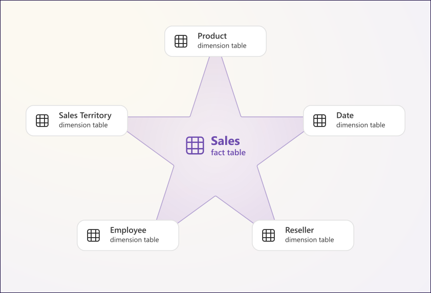

# Best Practice: Centralized Semantic Modeling (Star Schema)

Based on the [Power BI guidance documentation](https://learn.microsoft.com/en-us/power-bi/guidance/) and [Star schema design guidance](https://learn.microsoft.com/en-us/power-bi/guidance/star-schema)

## Overview

Semantic models (formerly "datasets") should be centralized, governed, and built on star schema principles. They are the single interface between the data platform and BI consumers. A well-designed model provides tables for **filtering and grouping** (dimensions) and tables for **summarization** (facts).

## Star schema fundamentals

### Fact tables

- Store observations or events (sales orders, balances, temperatures)
- Contain dimension key columns (foreign keys) and numeric measure columns
- Dimension keys determine **dimensionality**; key values determine **granularity**
- Always load data at a **consistent grain**
- Grow over time (large row counts)

### Dimension tables

- Describe business entities (products, customers, dates, stores)
- Contain a unique key column (surrogate key) plus descriptive attributes
- Enable filtering, grouping, and slicing
- Relatively small number of rows
- The most common dimension is the **date dimension table**

### Relationships

- **One-to-many** (dimension → fact) — The "one" side is always a dimension
- **Single-direction** filter propagation (dimension filters fact)
- Avoid bi-directional filtering unless explicitly required
- Every fact table foreign key should relate to a dimension

## Key star schema concepts

### Measures (DAX)

| Type | Description | When to use |
|------|-------------|-------------|
| **Explicit measures** | DAX formulas (SUM, AVERAGE, CALCULATE, etc.) that produce scalar values at query time | Always preferred — centralize business logic |
| **Implicit measures** | Auto-summarization of columns (Σ icon) | Acceptable for simple aggregations only |

**Why explicit measures matter:**
- Required for MDX queries (Analyze in Excel, PivotTables)
- Control how columns are summarized (prevent inappropriate SUM on unit prices)
- Enable complex calculations (time intelligence, ratios, KPIs)
- "Thin reports" pattern — reports only visualize, never define calculations

### Surrogate keys

- Add unique integer identifiers to dimension tables
- Required when source data lacks a single unique column
- Enable consistent one-to-many relationships
- Use Power Query index columns or data warehouse sequence generators

### Snowflake dimensions

| Approach | Pros | Cons |
|----------|------|------|
| **Denormalize** (flatten into one table) | Better performance, simpler model, supports hierarchies | More storage, redundant data |
| **Keep snowflake** (multiple tables) | Normalized source, less redundancy | More tables, longer filter chains, no cross-table hierarchies |

**Recommendation**: Denormalize into single dimension tables in most cases. Power BI models perform better with fewer tables.

### Role-playing dimensions

When a dimension relates to a fact multiple times (e.g., order date, ship date, due date):
- Create **inactive relationships** for additional roles
- Use `USERELATIONSHIP()` in DAX measures to activate the desired path
- Alternative: create separate physical copies of the date dimension (e.g., `dim_order_date`, `dim_ship_date`)

### Slowly changing dimensions (SCDs)

| Type | Behavior | Implementation |
|------|----------|---------------|
| **Type 1** | Overwrite — always shows current value | Simple UPDATE in ETL |
| **Type 2** | Track history — preserves all versions | Add effective date, end date, and current flag columns |

For Type 2 in Power BI:
- Filter to `IsCurrent = TRUE` for current-state analysis
- Use full history for point-in-time reporting
- Surrogate keys are essential (business keys repeat across versions)

### Other dimension patterns

| Pattern | When to use |
|---------|-------------|
| **Junk dimensions** | Consolidate low-cardinality flags/indicators into one table |
| **Degenerate dimensions** | Attributes stored directly in fact table (e.g., invoice number) |
| **Factless fact tables** | Record events with no numeric measures (e.g., student attendance) |

## Data model optimization

### Reduce model size

- Remove unused columns from the semantic model, and upstream when the columns aren't needed by any consumer
- Reduce column cardinality where possible (group rare values)
- Use appropriate data types (integers over strings)
- Disable auto date/time when you have your own date dimension
- Summarize detail-level data when grain isn't needed for analysis

> **Reference**: [Reduce data model size](https://learn.microsoft.com/en-us/power-bi/guidance/import-modeling-data-reduction)

### Search and approximate analytics features

Use newer semantic model features only when they match the business question:

| Capability | Use when | Watch-out |
|------------|----------|-----------|
| **Approximate distinct count** | High-cardinality counts need fast estimates and a small error tolerance is acceptable | Don't use for finance, compliance, or reconciliation metrics that require exact counts |
| **Full-text indexing / string search** | Users need natural-language-style search over text columns such as comments, tickets, descriptions, or feedback | Preview; validate compatibility level, storage mode, indexing cost, and whether exact text filters are still required |

Keep the model's default measures precise. Add approximate/search-optimized measures or columns deliberately and label them clearly so report users understand the trade-off.

### Date table design

- Always create a dedicated date dimension table
- Mark it as a **Date table** in Power BI
- Include: Date key, Year, Quarter, Month, Week, Day, Day of Week, Fiscal variants
- Disable auto date/time at the model level

> **Reference**: [Date table guidance](https://learn.microsoft.com/en-us/power-bi/guidance/model-date-tables)

### Relationship best practices

| Relationship type | Guidance |
|-------------------|----------|
| One-to-one | Rare — consider merging tables instead |
| Many-to-many | Use bridge/factless fact tables where possible; set cross-filter carefully |
| Bi-directional | Avoid unless required for specific filter patterns; impacts performance |
| Active vs. inactive | One active relationship per pair; use USERELATIONSHIP for alternates |

> **References**: [One-to-one relationships](https://learn.microsoft.com/en-us/power-bi/guidance/relationships-one-to-one) · [Many-to-many relationships](https://learn.microsoft.com/en-us/power-bi/guidance/relationships-many-to-many) · [Bi-directional filtering](https://learn.microsoft.com/en-us/power-bi/guidance/relationships-bidirectional-filtering)

## DirectQuery and composite model guidance

| Pattern | When to use |
|---------|-------------|
| **Import** | Best performance; data fits in capacity; refresh latency acceptable |
| **Direct Lake** | Large Fabric datasets in OneLake; low-latency freshness through framing/automatic updates; no import refresh |
| **DirectQuery** | Source data must stay external, source-enforced security/sovereignty is required, or real-time source queries are unavoidable |
| **Composite** | Mix Import, DirectQuery, and Direct Lake where supported; use aggregation tables or imported dimensions for performance |

**DirectQuery guidelines:**
- Treat DirectQuery as a deliberate exception in Fabric BI, not the default path when Direct Lake over OneLake tables is feasible
- Reduce table/column counts in the model
- Avoid complex DAX that can't translate to SQL
- Use dual storage mode for dimensions to improve performance
- Create aggregation tables for commonly queried grain levels

> **References**: [DirectQuery model guidance](https://learn.microsoft.com/en-us/power-bi/guidance/directquery-model-guidance) · [Composite model guidance](https://learn.microsoft.com/en-us/power-bi/guidance/composite-model-guidance)

## Row-level security (RLS) guidance

- Define RLS in the semantic model (not in reports)
- Use dynamic RLS with `USERPRINCIPALNAME()` for scalable user-based filtering
- Static RLS roles are appropriate for well-defined group-based access
- Test with "View as Role" before publishing
- Performance impact: RLS adds filter predicates to every query — test with realistic data volumes
- For Direct Lake with RLS, use a **fixed identity** cloud connection

> **Reference**: [RLS guidance](https://learn.microsoft.com/en-us/power-bi/guidance/rls-guidance)

## DAX best practices

| Practice | Rationale |
|----------|-----------|
| Use `DIVIDE()` instead of `/` operator | Handles divide-by-zero gracefully |
| Use `COUNTROWS()` instead of `COUNT()` | More explicit and performant |
| Use `SELECTEDVALUE()` instead of `VALUES()` | Returns BLANK for multiple values instead of error |
| Use variables (`VAR`) | Improves readability and avoids repeated evaluation |
| Avoid converting BLANKs to values | Unnecessary; BLANK propagates correctly in most cases |
| Avoid `FILTER()` as a filter argument | Use Boolean expressions directly in CALCULATE |
| Reference columns with `'Table'[Column]` | Unambiguous; measures without table prefix |

> **Reference**: [DAX best practices](https://learn.microsoft.com/en-us/dax/best-practices/dax-error-functions)

## Report architecture

### Separate reports from models

- **Shared semantic models** — Multiple reports connect to one certified model
- Avoid embedding data logic in report-level measures
- Enable "Discover datasets" for cross-workspace model reuse
- Use **thin reports** — reports only visualize, never transform
- Validate Power BI app distribution and licensing changes before choosing a sharing architecture; report/app licensing can influence whether Pro, PPU, or Fabric capacity is the right distribution path, but it doesn't change the need for shared governed semantic models.

### Report performance

- Limit visuals per page (< 8 recommended for fast rendering)
- Use bookmarks and drillthrough instead of cramming everything on one page
- Avoid high-cardinality slicers
- Monitor with Performance Analyzer

> **References**: [Separate reports from models](https://learn.microsoft.com/en-us/power-bi/guidance/report-separate-from-model) · [Monitor report performance](https://learn.microsoft.com/en-us/power-bi/guidance/monitor-report-performance)

## Governance guidelines

1. **One semantic model per domain** — Avoid creating separate models for each report
2. **Centralize business logic in measures** — DAX measures in the model, not in individual reports
3. **Thin reports** — Reports only visualize; they don't define calculations
4. **Certify and endorse** — Mark production semantic models as certified in Fabric
5. **Row-level security** — Define once in the semantic model, applies to all downstream reports
6. **Naming conventions** — Consistent naming across all models (see table below)
7. **Use deployment pipelines** — Promote models through dev → test → prod

## Naming conventions (recommended)

| Object | Convention | Example |
|--------|-----------|---------|
| Fact table | `fact_{business_process}` | `fact_sales` |
| Dimension table | `dim_{entity}` | `dim_customer` |
| Date dimension | `dim_date` | `dim_date` |
| Bridge/mapping table | `bridge_{relationship}` | `bridge_customer_account` |
| Measure | `{Verb} {Noun}` | `Total Revenue`, `Count Orders` |
| Measure (ratio/%) | `{Noun} %` or `{Noun} Rate` | `Margin %`, `Return Rate` |
| Calculated column | `_{description}` | `_full_name` |
| Measure folder | `_{domain}` | `_Sales Metrics`, `_Finance KPIs` |

## Anti-patterns to avoid

| Anti-pattern | Impact | Fix |
|---|---|---|
| **Wide flat tables** | Ambiguous grain, weak relationships, poor UX, and weaker compression/model governance | Split into star schema (facts + dims) |
| **Business logic in reports** | Inconsistent metrics across reports | Move to model-level DAX measures |
| **Separate model per report** | Duplicated logic, governance nightmare | Share certified semantic models |
| **Missing date dimension** | Can't do time intelligence, auto date/time overhead | Create explicit date table |
| **Bi-directional relationships everywhere** | Performance degradation, ambiguous paths | Use single-direction; bi-directional only when needed |
| **Snowflake without reason** | Extra tables, complexity, no hierarchy support | Denormalize dimensions |
| **Implicit measures only** | Can't use MDX, can't control aggregation | Create explicit DAX measures |
| **No surrogate keys** | Can't handle SCDs, composite keys cause issues | Add integer surrogate keys |

## Related anti-patterns

- [BI as transformation layer](../anti-patterns/bi-as-transformation-layer.md)
- [Wide denormalized tables](../anti-patterns/wide-denormalized-tables.md)

## References

### Core modeling guidance
- [Star schema design](https://learn.microsoft.com/en-us/power-bi/guidance/star-schema)
- [Power BI optimization guide](https://learn.microsoft.com/en-us/power-bi/guidance/power-bi-optimization)
- [Reduce data model size](https://learn.microsoft.com/en-us/power-bi/guidance/import-modeling-data-reduction)
- [APPROXIMATEDISTINCTCOUNT DAX function](https://learn.microsoft.com/en-us/dax/approximate-distinctcount-function-dax)
- [Configure full-text indexing in Power BI semantic models](https://learn.microsoft.com/en-us/analysis-services/azure-analysis-services/full-text-indexing?view=power-bi-premium-current)
- [Date table design](https://learn.microsoft.com/en-us/power-bi/guidance/model-date-tables)

### Relationships
- [One-to-one relationships](https://learn.microsoft.com/en-us/power-bi/guidance/relationships-one-to-one)
- [Many-to-many relationships](https://learn.microsoft.com/en-us/power-bi/guidance/relationships-many-to-many)
- [Active vs. inactive relationships](https://learn.microsoft.com/en-us/power-bi/guidance/relationships-active-inactive)
- [Bi-directional filtering](https://learn.microsoft.com/en-us/power-bi/guidance/relationships-bidirectional-filtering)

### Query and performance
- [DirectQuery model guidance](https://learn.microsoft.com/en-us/power-bi/guidance/directquery-model-guidance)
- [Composite model guidance](https://learn.microsoft.com/en-us/power-bi/guidance/composite-model-guidance)
- [Direct Lake overview](https://learn.microsoft.com/en-us/fabric/fundamentals/direct-lake-overview)
- [Query folding](https://learn.microsoft.com/en-us/power-bi/guidance/power-query-folding)

### Security and governance
- [RLS guidance](https://learn.microsoft.com/en-us/power-bi/guidance/rls-guidance)
- [Separate reports from models](https://learn.microsoft.com/en-us/power-bi/guidance/report-separate-from-model)
- [Fabric adoption roadmap](https://learn.microsoft.com/en-us/power-bi/guidance/fabric-adoption-roadmap)

### DAX
- [DAX best practices](https://learn.microsoft.com/en-us/dax/best-practices/dax-error-functions)
- [Use variables](https://learn.microsoft.com/en-us/dax/best-practices/dax-variables)
- [DIVIDE function guidance](https://learn.microsoft.com/en-us/dax/best-practices/dax-divide-function-operator)
