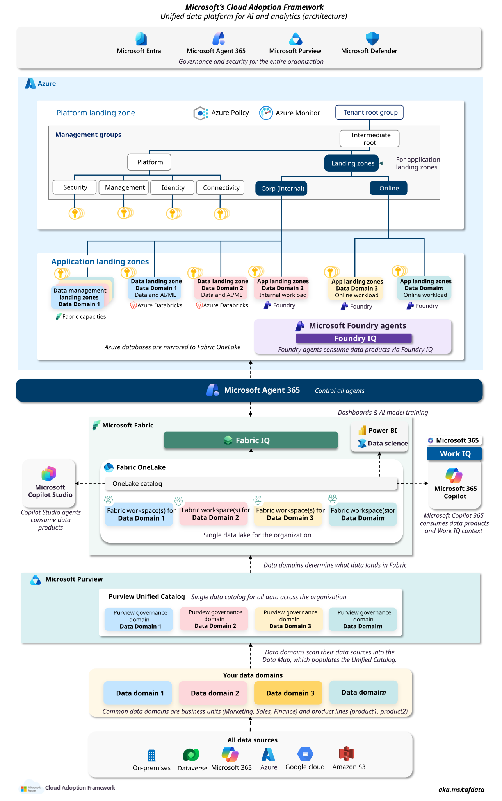

# Data Architecture for Fabric Data Agents

Based on [Cloud Adoption Framework: Data architecture plan for AI agents](https://learn.microsoft.com/en-us/azure/cloud-adoption-framework/ai-agents/data-architecture-plan)

## Core architecture

Fabric Data Agents and related agentic experiences consume data through governed interfaces built on your Fabric platform:

## Step 1: Unify your data platform

Before building agents, ensure your Fabric data estate is unified:

| Requirement | Implementation |
|-------------|---------------|
| Single data foundation | OneLake with Medallion architecture (Bronze → Silver → Gold) |
| Governed data products | Gold layer datasets certified, owned, documented |
| Quality enforcement | Silver layer validation, typed schemas, deduplication |
| Security boundaries | Workspace isolation, OneLake security, RLS/CLS, sensitivity labels, Purview policy controls |
| Discoverability | OneLake catalog, domain assignments |

**If your data is fragmented across silos, stop here.** Fix the data platform first — agents built on fragmented data produce unreliable results.

## Step 2: Prepare data for agent consumption

### Fabric Data Agents (governed Fabric sources)

Use Fabric data agents for conversational analytics over supported governed sources. A single data agent can combine up to five sources, but it should still stay focused on one domain or use case.

| Source category | Best use |
|-----------------|----------|
| SQL sources: Lakehouse, Warehouse, Fabric SQL Database, mirrored databases | Structured analytical questions over curated tables, views, and functions |
| Eventhouse KQL database | Real-time, log, telemetry, and time-series questions |
| Power BI semantic model | Trusted KPIs, measures, hierarchies, RLS/CLS, and curated business metrics |
| Graph model (preview) | Relationship-heavy questions and graph traversal |
| Ontology (preview) | Shared business vocabulary and cross-domain semantic grounding |
| Azure AI Search index (preview) | Unstructured documents exposed through a governed search index |

For semantic models, configure **Prep for AI** in Power BI before adding the source:

1. **AI Data Schema** — Select only relevant tables/columns/measures.
2. **Verified Answers** — Pre-approved responses for common questions.
3. **AI Instructions** — Business terminology, metric definitions, routing rules.

### Microsoft 365 data

For agents that access SharePoint, OneDrive, Teams content:

- Ensure document-level permissions are correct
- Apply sensitivity labels consistently
- Remove stale/duplicate content that could confuse agents

### Real-time data and actions

Fabric data agents can query Eventhouse KQL databases directly for real-time and time-series analytics. Use MCP servers or orchestrators for live operational APIs or actions that are outside the read-only data agent scope, such as inventory checks, ticket creation, approvals, or workflow updates.

- Identify candidate systems (CRM, ERP, ITSM, IoT)
- Define read-only vs. read-write access patterns
- Enforce authentication on every tool call
- Use identity passthrough when user permissions must persist

## Step 3: Define data retrieval strategy

| Retrieval type | When to use | Example |
|----------------|-------------|---------|
| **Fabric data agent / Fabric IQ** | Default for governed Fabric analytical data products, including published-agent MCP endpoint consumption | "What were Q4 sales by region?" |
| **Search (Azure AI Search)** | Unstructured docs and knowledge bases | "What's our refund policy?" |
| **MCP servers** | External live queries or actions | "Create a support ticket for this data quality issue." |
| **Microsoft Graph** | Microsoft 365 content | "Find the latest sales deck" |

**Priority order:** Built-in retrieval → Search → MCP → Custom

## Step 4: Document retrieval decisions

For each agent, document:

| Field | Example |
|-------|---------|
| Data domain | Product inventory |
| Retrieval method | MCP (real-time API call) |
| Source system | ERP order management |
| Access pattern | Read-only |
| Authentication | Entra identity passthrough |
| Governance | Certified data product, audit logged |

## Key principles for agent-ready data

1. **Agents don't bypass security** — They respect existing permissions, labels, and policies
2. **Quality in = Quality out** — Poorly governed data produces unreliable agent responses
3. **Built-in first** — Use Fabric data agents, Fabric IQ, and supported Fabric sources before building custom retrieval
4. **Document everything** — Retrieval decisions need to be auditable
5. **Separate concerns** — Agent instructions ≠ data model configuration (see anti-patterns)

## References

- [Data architecture plan for AI agents](https://learn.microsoft.com/en-us/azure/cloud-adoption-framework/ai-agents/data-architecture-plan)
- [Unify your data platform](https://learn.microsoft.com/en-us/azure/cloud-adoption-framework/data/executive-strategy-unify-data-platform)
- [Fabric IQ overview](https://learn.microsoft.com/en-us/fabric/iq/overview)
- [Add data sources to a Fabric data agent](https://learn.microsoft.com/en-us/fabric/data-science/data-agent-add-datasources)
- [Data agent as a Model Context Protocol server](https://learn.microsoft.com/en-us/fabric/data-science/data-agent-mcp-server)
- [Connect to MCP servers (Foundry)](https://learn.microsoft.com/en-us/azure/ai-foundry/agents/how-to/tools/model-context-protocol)
