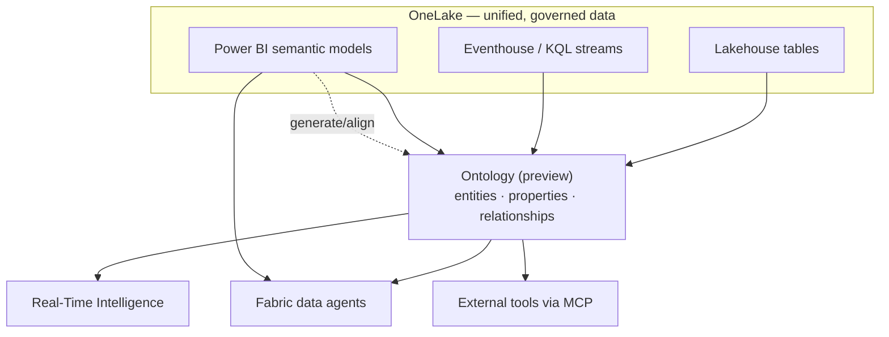
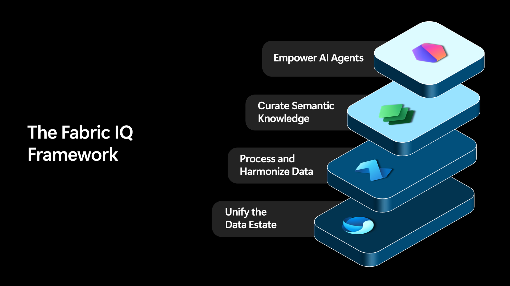

# Ontologies & Fabric IQ: A Shared Semantic Layer for Agents

Based on [What is Fabric IQ?](https://learn.microsoft.com/en-us/fabric/iq/overview) and [What is Ontology (preview)?](https://learn.microsoft.com/en-us/fabric/iq/ontology/overview)

> **Preview:** The **ontology** item is in preview. Validate current capabilities and tenant requirements against the official docs before relying on it in production.

## Why this matters for agents

AI agents reason best when they share the *same governed vocabulary* that humans use. A semantic model gives Power BI a curated analytics layer; an **ontology** goes further — it defines your business concepts (entities, properties, relationships) **once**, binds them to real OneLake data, and exposes that shared meaning to reports, agents, and applications alike. Without a shared semantic layer, every agent re-invents "what is a Customer" and answers drift across teams.

## Fabric IQ in the Microsoft IQ stack

**Fabric IQ** is the part of Microsoft IQ that provides context on your **business entities and data**. It works alongside:

| Layer | Provides context on |
|-------|---------------------|
| **Fabric IQ** | Business entities and data (the state of your business) |
| **Work IQ** | How employees work (Microsoft 365) |
| **Foundry IQ** | Organizational policies and authoritative documents |
| **Web IQ** | Information from the web |

Fabric IQ delivers three layers of business context through **two core items** — the **ontology (preview)** and the **Power BI semantic model** — all grounded in a single, governed source of truth in OneLake. The Fabric IQ workload also includes related items such as Plan, Graph, Data agent, and Operations agent for analyzing, consuming, and operationalizing that context:

| Layer | Delivered by | Role |
|-------|--------------|------|
| **Unified data** | OneLake (shortcuts, mirroring, catalog) | Multicloud governed foundation and distribution layer |
| **Business intelligence** | Power BI semantic models | Curated measures, hierarchies, dimensions |
| **Operational intelligence** | Ontology + Real-Time Intelligence | Cross-domain reasoning over live + analytical data |

| IQ workload item | Primary role |
|------------------|--------------|
| Ontology (preview) | Shared business vocabulary, entity relationships, rules, and actions |
| Power BI semantic model | Curated BI metrics, hierarchies, measures, and trusted analytical logic |
| Plan | Planning, forecasting, and reporting over a shared data foundation |
| Graph (preview) | Relationship-heavy graph storage and traversal |
| Data agent | Domain-specific conversational analytics over supported Fabric sources |
| Operations agent | Real-time monitoring and governed action recommendations |

## What an ontology is

An *ontology* is a shared, machine-understandable vocabulary of your business — the **things**, their **facts**, and how they **connect** — with constraints that keep representations consistent. Think of it as a business context layer containing:

- A **catalog of concepts** (Product, Order, Plant, Sensor, Route) defined once and reused everywhere
- **Data bindings** linking those concepts to actual OneLake sources
- A **graph representation** for navigation, lineage, and reasoning
- A **query surface** to ask questions about concepts (not tables), including federated queries across sources

### Core modeling concepts

| Concept | Definition | Why it matters |
|---------|-----------|----------------|
| **Entity type** | Reusable logical model of a real-world concept (Shipment, Product, Sensor) | Elevates a concept above any single table so every team means the same thing |
| **Entity instance** | A concrete occurrence populated from data bindings, with source + validity tracking | Turns raw rows into standardized business objects agents understand identically |
| **Property** | A named fact with a declared data type, bindings, and semantic annotations | Enforces consistent types, units, naming, and quality checks at the concept level |
| **Relationship** | A typed, directional link between entities, with attributes and cardinality | Makes context explicit and reusable — traversal and inference without custom join logic |

### Your data in the ontology

- **Data binding** — connects entity types, properties, and relationships to concrete data in OneLake (lakehouse tables, eventhouse streams, and Power BI semantic models). Bindings describe data types, identity keys, and column/key mappings, and enforce schema-evolution rules, quality checks, and provenance. See [Bind data to an ontology](https://learn.microsoft.com/en-us/fabric/iq/ontology/how-to-bind-data).
- **Ontology graph** — a queryable instance graph built from bindings and relationships (nodes = instances, edges = links with metadata and lineage). Requires **Graph in Microsoft Fabric** to be enabled at the tenant level ([Graph overview](https://learn.microsoft.com/en-us/fabric/graph/overview)).
- **Querying** — ask business-level questions using ontology terminology. The layer routes to the most efficient engine (for example GQL for Graph, KQL for Eventhouse) and includes **NL2Ontology** to convert natural language into structured queries that respect published definitions.

> **Refresh caveat:** Upstream changes (such as new rows) require a **manual graph refresh** before they're visible in the ontology item. Plan a refresh cadence.

## Ontology vs. Power BI semantic model

They are complementary, not competing. You can **generate or align an ontology directly from a semantic model** already in production, keeping business language consistent across reports, agents, and apps.

| Dimension | Power BI semantic model | Ontology (preview) |
|-----------|-------------------------|--------------------|
| Primary purpose | Curated analytics (measures, hierarchies) | Cross-domain shared business vocabulary |
| Shape | Star schema (facts + dimensions) | Entities + properties + relationships (graph) |
| Query style | DAX / NL2DAX | NL2Ontology, GQL/KQL routing, federated |
| Best for | BI reporting, single-domain analytics | Reasoning across processes/domains, agent grounding |
| Consumers | Power BI, data agents | Fabric data agents, Real-Time Intelligence, external tools (MCP) |

### When to use an ontology

- ✅ You need **cross-domain consistency** — the same concept spans lakehouse, eventhouse, and semantic models
- ✅ You want a **governed shared model** for humans *and* agents, not per-agent definitions
- ✅ Agents must **reason across processes** (e.g., "which open Shipments touch a Plant with an active Breach?")
- ✅ You need **relationship traversal / graph reasoning** beyond a single star schema
- ⚖️ For a single-domain BI question answered by one star schema, a well-configured **semantic model alone** is sufficient — don't add an ontology just because you can

## Best practices

- ✅ **Define concepts once, bind many.** Model enterprise concepts (Customer, Shipment, Breach) at the entity level and bind them across all relevant OneLake sources — don't redefine per report or per agent.
- ✅ **Generate from existing semantic models** where one exists, so terminology and KPIs stay aligned across BI and agents.
- ✅ **Enforce quality at the binding layer** (nullability, ranges, uniqueness, provenance) so agents consume governed business objects, not raw rows.
- ✅ **Model relationships explicitly** with correct cardinality — this is what lets agents answer cross-domain questions without hand-written joins.
- ✅ **Establish a refresh cadence** for the ontology graph so agents don't reason over stale instances.
- ✅ **Expose the ontology to agents as a shared layer**, then let Fabric data agents route to it alongside lakehouse/warehouse/KQL sources.
- ✅ **Reuse ontology-grounded agents across surfaces** — publish focused data agents and expose them through Copilot Studio, MCP clients, Foundry agents, or custom apps instead of rebuilding the same business context per channel.
- ✅ **Govern like any data product** — ownership, lineage, and access policies per the [governance best practices](../best-practices/governance.md).

## Platform update: operational loop and semantic reuse

Recent Fabric IQ announcements emphasize Fabric as an operational loop: **observe** live signals, **analyze** them with shared business meaning, **decide** with policy and delegated authority in context, then **act** through governed people-and-agent workflows. Ontologies are the reusable business model in that loop.

Architecture implications:

- Use ontologies to connect live Eventhouse/Real-Time Intelligence signals with analytical history, semantic-model measures, mirrored operational data, and approved actions.
- Treat ontology AI generation, semantic-model bindings, ontology metrics, RDF import/export, versioning, namespaces, and relationship modeling as accelerators — still review the model with domain owners before production use.
- Keep Fabric IQ context portable. IQ sharing, RDF/ontology reuse, semantic-model alignment, and MCP-enabled data agents should reduce duplicate prompt logic, not create another unmanaged semantic layer.
- Mark preview capabilities clearly and validate tenant settings, region availability, and source support before making them customer commitments.

## The Fabric IQ Framework

Ontologies and semantic models are the middle of a four-stage journey. Fabric IQ organizes the path from raw data to trustworthy agents as a layered stack — each layer builds on the one below it:

| # | Layer | What happens | Fabric capabilities | Repo guidance |
|---|-------|--------------|---------------------|---------------|
| 4 | **Empower AI Agents** | Governed agents answer and act on business questions | Fabric data agents, Ontology/MCP consumers, Copilot | [data-agent-best-practices.md](data-agent-best-practices.md) |
| 3 | **Curate Semantic Knowledge** | Define shared business meaning once, for humans and agents | Power BI semantic models, **ontology (preview)** | This doc |
| 2 | **Process and Harmonize Data** | Clean, conform, and standardize into trustworthy products | Medallion (Bronze→Silver→Gold), pipelines, dataflows, notebooks | [medallion-architecture.md](../best-practices/medallion-architecture.md) |
| 1 | **Unify the Data Estate** | One governed, multicloud source of truth | OneLake, shortcuts, mirroring, catalog | [data-architecture-for-agents.md](data-architecture-for-agents.md) |

> **Read bottom-up.** You can't skip layers: agents built before the data is unified, harmonized, and semantically curated inherit every gap below them. Ontologies and semantic models (layer 3) are what turn harmonized data into a *shared language* that layer-4 agents can reason over.

## References

- [What is Fabric IQ?](https://learn.microsoft.com/en-us/fabric/iq/overview)
- [What is Ontology (preview)?](https://learn.microsoft.com/en-us/fabric/iq/ontology/overview)
- [Bind data to an ontology](https://learn.microsoft.com/en-us/fabric/iq/ontology/how-to-bind-data)
- [Graph in Microsoft Fabric overview](https://learn.microsoft.com/en-us/fabric/graph/overview)
- [OneLake overview](https://learn.microsoft.com/en-us/fabric/onelake/onelake-overview)
- [Fabric data agent concept](https://learn.microsoft.com/en-us/fabric/data-science/concept-data-agent)
