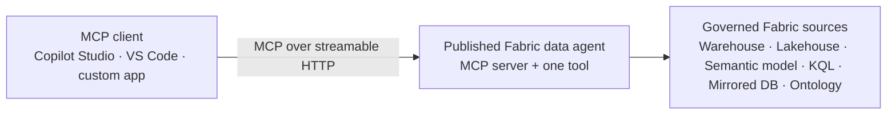

# Fabric Data Agent MCP Server

**Source:** [Data agent as Model Context Protocol server](https://learn.microsoft.com/en-us/fabric/data-science/data-agent-mcp-server)

## What it is

A published Fabric data agent can act as a remote MCP server. It exposes one MCP tool that lets an MCP client ask questions against the governed data sources the agent can reach in Fabric.

Use this when an external agent, Copilot Studio experience, VS Code workflow, or custom MCP client needs conversational access to Fabric data through an already-scoped data agent instead of a broad SQL or REST tool surface.

## Best fit

| Use case | Why this server fits |
|----------|----------------------|
| Domain Q&A from an MCP client | The data agent already contains the source selection, instructions, and governed data scope |
| Copilot Studio / agent orchestration | The agent can be added as a tool while preserving Fabric permissions and published-agent behavior |
| Fabric IQ / ontology-grounded answers | The data agent can answer over supported sources such as lakehouse, warehouse, semantic model, KQL database, mirrored database, or ontology |
| Read-oriented customer demos | One published endpoint is easier to explain and govern than multiple low-level tools |

## Guardrails

- Publish the data agent first; the MCP endpoint exists only for a published agent.
- Write a clear data agent description because MCP clients use it as the tool description when deciding whether to call the agent.
- Validate the MCP client data boundary. Responses can leave Fabric and be processed or stored under the MCP client's terms, region, and compliance boundary.
- Use least-privilege Fabric access and prefer user identity passthrough where user-level authorization must remain intact.
- Remember this is MCP, not a generic REST endpoint: clients must perform the MCP initialize, tools/list, and tools/call flow and attach a valid Fabric bearer token.

## Architecture placement

## References

- [Data agent as Model Context Protocol server](https://learn.microsoft.com/en-us/fabric/data-science/data-agent-mcp-server)
- [Fabric data agent concept](https://learn.microsoft.com/en-us/fabric/data-science/concept-data-agent)
- [Fabric Data Agent best practices](../../fabric-data-agents/data-agent-best-practices.md)
