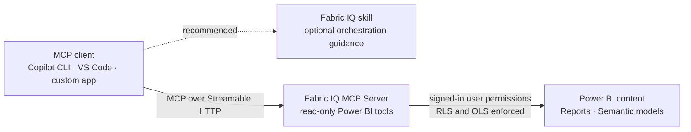

# Fabric IQ MCP Server

**Source:** [Get started with the Fabric IQ MCP server](https://learn.microsoft.com/en-us/fabric/iq/connectors/fabric-iq-mcp)

Endpoint: `https://fabriciq.svc.cloud.microsoft/v1/mcp/fabriciq`

Private Link endpoint: `https://api.fabric.microsoft.com/v1/mcp/fabriciq`

## What it is

Fabric IQ MCP is a remote, generally available MCP server that connects MCP-compatible clients to Power BI reports and semantic models in Microsoft Fabric.

Use this when an AI agent needs read-only, authenticated access to discover Power BI content, inspect report and semantic model metadata, locate values, and run DAX queries against data the signed-in user can access.

Fabric IQ MCP does **not** expose a natural-language answering tool. The calling agent or skill must choose tools, compose DAX, interpret metadata, and explain results.

## Best fit

| Use case | Why this server fits |
|----------|----------------------|
| Power BI report or semantic model exploration from an MCP client | The server can discover reports and semantic models by name or supported browser URL |
| Semantic model schema inspection | `GetSemanticModelSchema` lets the agent inspect tables, columns, measures, relationships, and model structure |
| Report-aware Q&A workflows | `GetReportMetadata` gives the agent report context before it generates a focused query |
| Value lookup before DAX generation | `ValueSearch` can help locate exact stored values before filtering or querying |
| Read-only DAX execution | `ExecuteQuery` runs DAX against one semantic model under the signed-in user's permissions |

## Available tools

| Tool | What it does |
|------|--------------|
| `DiscoverArtifacts` | Searches for Power BI reports and semantic models by name |
| `ResolveFabricItem` | Resolves a supported Fabric item URL for later tool calls |
| `GetReportMetadata` | Retrieves Power BI report metadata |
| `GetSemanticModelSchema` | Retrieves semantic model schema information |
| `ValueSearch` | Searches a semantic model for specific stored values |
| `ExecuteQuery` | Runs a DAX query against a semantic model |

## Recommended pairing

Pair Fabric IQ MCP with the [Fabric IQ skill](https://github.com/microsoft/skills-for-fabric/blob/main/skills/fabriciq/SKILL.md) from Skills for Fabric when possible. The skill teaches the agent how to identify Power BI content, interpret report and semantic model context, coordinate Fabric IQ tools, and apply guardrails. The MCP server provides the authenticated live tool surface.

## Guardrails

- Use the runtime `tools/list` response as authoritative; do not hard-code assumed tool schemas.
- Pin the public tool contract with `X-Variants: Fabric.Routing.FabricIQ.V1` when repeatability matters.
- Do not add a static `Authorization` bearer token to the recommended Copilot CLI configuration; it overrides interactive OAuth and token refresh.
- Use delegated Microsoft Entra authentication. Service-principal and application-only authentication are not supported.
- Validate tenant support, client Streamable HTTP support, and OAuth flow requirements before customer delivery.
- Remember that RLS and OLS still apply, and different users can receive different results for the same query.
- Keep queries focused. `ExecuteQuery` targets one semantic model per call and defaults to 250 rows when `maxRows` is not specified.
- Review where MCP client prompts, metadata, query results, embedded CSV resources, and chat transcripts are processed or stored.

## Distinguish from Data Agent MCP

Fabric IQ MCP and Fabric Data Agent MCP are complementary, not interchangeable:

| Need | Prefer |
|------|--------|
| Power BI report and semantic model discovery, metadata, value search, and DAX execution | Fabric IQ MCP Server |
| Governed natural-language Q&A through a published Fabric data agent over scoped Fabric sources | Fabric Data Agent MCP Server |
| Ontology or data-agent-backed answers | Fabric Data Agent MCP Server |
| Workspace, item, folder, or permission operations | Fabric Core MCP Server |

Fabric IQ MCP currently supports Power BI reports and semantic models. It does not support Power BI dashboards, paginated reports, Power BI apps, Fabric ontologies, or data agents.

## Architecture placement

## References

- [Get started with the Fabric IQ MCP server](https://learn.microsoft.com/en-us/fabric/iq/connectors/fabric-iq-mcp)
- [Skills for Fabric overview](https://learn.microsoft.com/en-us/fabric/fundamentals/skills-for-fabric-overview)
- [Fabric IQ skill](https://github.com/microsoft/skills-for-fabric/blob/main/skills/fabriciq/SKILL.md)
