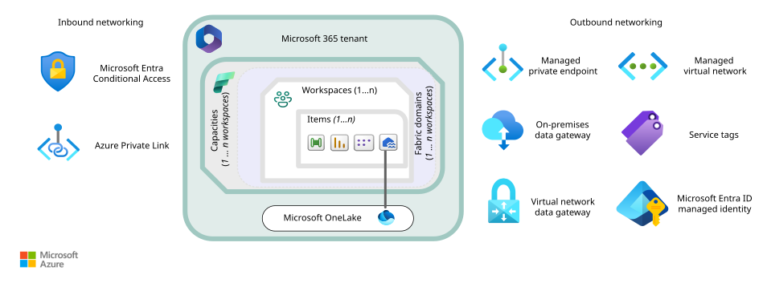

# Reference Architecture: Fabric Deployment Patterns

Based on [Choose a Microsoft Fabric Deployment Pattern](https://learn.microsoft.com/en-us/azure/architecture/data-guide/technology-choices/fabric-deployment-patterns)

## Four-level hierarchy

All Fabric deployments follow this hierarchy:



## Key decisions at each level

| Level | Controls | Key decision |
|-------|----------|-------------|
| **Tenant** | Identity, conditional access, private links, sensitivity labels | Single tenant (standard) or multi-tenant (rare, complex) |
| **Capacity** | Data residency (Azure region), billing, CU allocation | How many capacities? Shared vs. dedicated per workload? |
| **Workspace** | Access control (4 roles), Git integration, deployment pipelines | How to organize? By layer? By domain? By team? |
| **Item** | Lakehouses, warehouses, notebooks, pipelines, reports | Naming, permissions, lifecycle |

## Deployment patterns

### Pattern 1: Monolithic deployment (single workspace)

```
Capacity
└── Workspace (all items: lakehouse, pipeline, reports)
```

- ✅ Simple, fast to set up, lower admin overhead
- ❌ No deployment pipelines (requires multiple workspaces)
- ❌ No governance separation between teams
- ❌ Single region only
- **Use for:** Small organizations, POCs, low-complexity environments with shared roles

### Pattern 2: Multiple workspaces, single capacity

```
Capacity
├── Workspace-A  (e.g., ingestion / bronze+silver)
├── Workspace-B  (e.g., consumption / gold)
└── Workspace-C  (e.g., reporting)
```

- ✅ Enables deployment pipelines and lifecycle management
- ✅ Workspace-level access control and Git integration
- ✅ Supports data mesh via Fabric domains grouping workspaces
- ❌ Shared CUs — workloads can throttle each other
- ❌ Single region only
- **Use for:** Medium teams needing governance separation without capacity isolation

### Pattern 3: Multiple workspaces, separate capacities

```
Capacity-A (East US)
├── Sales-Bronze-Workspace
├── Sales-Silver-Workspace
└── Sales-Gold-Workspace

Capacity-B (West Europe)
├── Finance-Bronze-Workspace
└── Finance-Gold-Workspace
```

- ✅ Performance isolation between business units
- ✅ Multi-geo support (capacities in different Azure regions)
- ✅ Independent scaling per domain
- ✅ Full DevOps capabilities (deployment pipelines, Git)
- ✅ OneLake shortcuts for cross-workspace data access without copying
- ❌ More capacities to manage and monitor
- **Use for:** Large organizations, data mesh, regulated industries, multi-region deployments

### Pattern 4: Multiple Fabric tenants

```
Tenant A (Production)                    Tenant B (Development/ISV)
├── Capacity-Prod                        ├── Capacity-Dev
│   ├── Workspace-1                      │   ├── Workspace-Sandbox
│   └── Workspace-2                      │   └── Workspace-Test
└── Capacity-Analytics                   └── ...
```

- ✅ Maximum isolation (identity, network, data)
- ✅ Separate admin boundaries
- ✅ Required for ISV multi-tenancy or strict regulatory separation
- ❌ No cross-tenant OneLake shortcuts
- ❌ Complex identity and data sharing between tenants
- ❌ Highest operational overhead
- **Use for:** ISVs, M&A scenarios, government/defense, strict data sovereignty requirements

## Capacity planning considerations

| Factor | Guidance |
|--------|----------|
| **Workload isolation** | Separate BI (interactive) from engineering (batch) on different capacities |
| **Bursting** | Fabric allows temporary CU bursting; monitor to avoid throttling |
| **Pause/resume** | Dev/Test capacities can be paused off-hours to save cost |
| **Geo-residency** | Each capacity is bound to an Azure region; use for data sovereignty |
| **F64+ threshold** | Users with a Power BI Free license can view content on qualifying capacity with the appropriate viewer permissions. [Check requirements](https://learn.microsoft.com/en-us/power-bi/fundamentals/end-user-features) |

## Fabric domains

Domains are logical groupings that organize workspaces by business unit:

- Enable **delegated governance** without tenant-admin privileges
- Appear in **OneLake catalog** for discovery
- Support **domain-level settings** that override tenant defaults
- Align with **Medallion layers** or **business units** (or both)

## Common patterns shared across all deployments

Regardless of which pattern you choose:

1. **Workspaces are the governance boundary** — permissions, Git, deployment pipelines
2. **Use Fabric domains** to group workspaces and delegate administration
3. **Dedicate capacity** for performance-critical workloads
4. **OneLake catalog** for asset discovery across the tenant
5. **OneLake security roles** for fine-grained access (table, folder, column, row)

## Choosing your pattern

| Criteria | Pattern 1 | Pattern 2 | Pattern 3 | Pattern 4 |
|----------|:---------:|:---------:|:---------:|:---------:|
| Team size | 1-5 | 5-20 | 20-100 | 100+ |
| Governance needs | Minimal | Moderate | High | Maximum |
| CI/CD support | ❌ | ✅ | ✅ | ✅ |
| Domain isolation | ❌ | ❌ | ✅ | ✅ |
| Environment isolation | ❌ | ✅ | ⚖️ | ✅ |
| Complexity | Low | Low-Medium | Medium | High |

## References

- [Choose a Fabric Deployment Pattern](https://learn.microsoft.com/en-us/azure/architecture/data-guide/technology-choices/fabric-deployment-patterns)
- [Fabric domains](https://learn.microsoft.com/en-us/fabric/governance/domains)
- [Fabric workspace roles](https://learn.microsoft.com/en-us/fabric/fundamentals/roles-workspaces)
- [Deployment pipelines](https://learn.microsoft.com/en-us/fabric/cicd/deployment-pipelines/intro-to-deployment-pipelines)
- [OneLake catalog](https://learn.microsoft.com/en-us/fabric/governance/onelake-catalog-overview)
