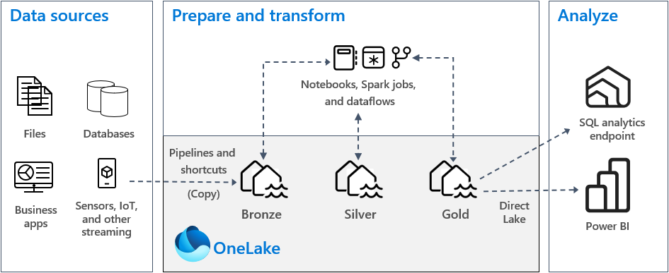

# Reference Architecture: End-to-End Medallion on Fabric

Based on [Implement a medallion lakehouse architecture in Microsoft Fabric](https://learn.microsoft.com/en-us/fabric/onelake/onelake-medallion-lakehouse-architecture)

A complete reference showing how data flows from source systems through Medallion layers to business consumers using Microsoft Fabric components.

## Architecture diagram



## Component mapping

| Stage | Fabric Component | Purpose |
|-------|-----------------|---------|
| Batch ingestion | Data Pipelines | 200+ connectors, scheduled/triggered |
| CDC replication | Mirroring | Continuous replication from operational DBs |
| No-copy access | Shortcuts | Virtualize external data (ADLS, S3, other Lakehouses) |
| Streaming | Eventstream | Real-time event ingestion and routing |
| Storage (all layers) | Lakehouse + OneLake | Delta tables in a unified data lake |
| Transformation | Notebooks / Dataflows Gen2 | Code-first (Spark/Python) or low-code (Power Query) |
| Serving (BI) | Semantic Model + Direct Lake | Near-import performance, no refresh needed |
| Serving (SQL) | SQL Endpoint / Warehouse | Ad-hoc SQL, cross-database queries |
| Serving (real-time) | Eventhouse + KQL | Sub-second queries on streaming data |
| AI/ML | Data Science workload | MLflow experiments, model registry |
| Governance | Purview + OneLake Catalog | Lineage, classification, discovery |
| CI/CD | Git + Deployment Pipelines | Version control and promotion across environments |

## Data flow principles

1. **Data lands once in OneLake** — No duplication across systems
2. **Each contract layer is governed** — Persist Delta checkpoints for reusable Silver/Gold boundaries; preserve raw Bronze/source formats when audit fidelity requires it
3. **Transformations are code** — Versioned in Git, testable, reviewable
4. **Consumers read from Gold** — Never from Bronze or Silver (except data engineers)
5. **Direct Lake avoids import refresh** — Semantic models use framing/automatic updates to align with Gold data without importing it

## Capacity layout (recommended)

```
┌─────────────────────────────┐    ┌─────────────────────────────┐
│  Engineering Capacity (F64) │    │     BI Capacity (F64)       │
│                             │    │                             │
│  • Bronze ingestion         │    │  • Gold Lakehouse (read)    │
│  • Silver transformation    │    │  • Semantic models          │
│  • Gold curation            │    │  • Power BI reports         │
│  • Notebooks / Spark        │    │  • Data Agent               │
└─────────────────────────────┘    └─────────────────────────────┘
```

Separating engineering and BI onto different capacities prevents batch Spark jobs from competing with interactive report queries.

## References

- [Fabric data lifecycle](https://learn.microsoft.com/en-us/fabric/fundamentals/data-lifecycle)
- [Medallion Lakehouse Architecture](https://learn.microsoft.com/en-us/fabric/onelake/onelake-medallion-lakehouse-architecture)
- [Direct Lake overview](https://learn.microsoft.com/en-us/fabric/fundamentals/direct-lake-overview)
- [OneLake overview](https://learn.microsoft.com/en-us/fabric/onelake/onelake-overview)
