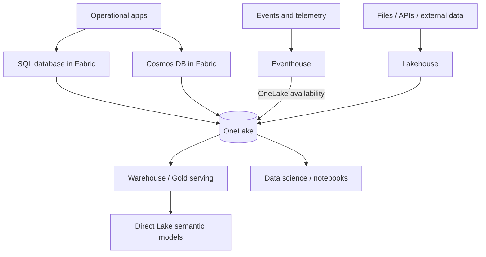

# Fabric Data Store Decision Guide

Based on [Fabric decision guide - choose a data store](https://learn.microsoft.com/en-us/fabric/fundamentals/decision-guide-data-store).

## Overview

Choose the Fabric data store by workload shape, not by habit. All Fabric data stores participate in OneLake, but they optimize for different access patterns, personas, languages, and operational needs.

## Decision matrix

| Need | Preferred Fabric store | Why |
|------|------------------------|-----|
| Streaming event data, logs, telemetry, high-granularity interactive analytics | **Eventhouse** | Optimized for time-series, log, geospatial, and high-volume interactive analytics with KQL and real-time dashboards |
| NoSQL app data, evolving JSON documents, AI app state, vector or hybrid search | **Cosmos DB in Fabric** | Operational NoSQL store with OneLake availability and AI-oriented indexing/search patterns |
| Operational relational app data, OLTP, normalized transactional workloads | **SQL database in Fabric** | Transactional SQL engine for application write paths, with replicated analytical access through OneLake |
| PostgreSQL-compatible operational applications | **Fabric HorizonDB (preview)** | Native managed PostgreSQL with OneLake integration. Evaluate only within current preview limits, including creator-only connectivity |
| Enterprise data warehouse, SQL BI, OLAP, dimensional serving, multi-table SQL transactions | **Fabric Data Warehouse** | T-SQL warehouse serving, star schema modeling, SQL tools, and BI/OLAP workloads |
| Big data engineering, ML, notebooks, semi-structured or unstructured data, Delta processing | **Lakehouse** | Spark and Delta-first data engineering/ML pattern for medallion processing and open data |

## Recommended architecture pattern

Use operational stores for operational writes, Eventhouse for event analytics, Lakehouse for engineering and ML, Warehouse for curated SQL serving, and Direct Lake semantic models for BI consumption over governed Gold data.

## Common decisions

| Decision | Recommendation |
|----------|----------------|
| Lakehouse vs. Warehouse | Choose Lakehouse for Spark, Delta engineering, ML, semi-structured data, and medallion processing. Choose Warehouse for SQL-first dimensional serving, T-SQL development, and warehouse-style BI. |
| SQL database vs. Warehouse | Choose SQL database for OLTP/application writes. Choose Warehouse for analytical SQL and BI. Don't use Warehouse or Lakehouse as an OLTP store. |
| Eventhouse vs. Lakehouse | Choose Eventhouse for streaming events, logs, time filters, KQL, real-time dashboards, and operational analytics. Use Lakehouse when batch engineering, ML, or broad Delta processing is the primary job. |
| Cosmos DB vs. SQL database | Choose Cosmos DB for NoSQL, flexible schema, document modeling, vector, full-text, or hybrid search. Choose SQL database when relational integrity, T-SQL, and normalized transactional design are central. |
| Warehouse vs. Direct Lake semantic model | Warehouse is a serving and query engine. Direct Lake semantic models are the BI semantic layer over curated tables. Use both when SQL serving and governed BI metrics are needed. |

## Anti-patterns

- 🚫 **Choosing one store for every workload** — Fabric is unified, not one-size-fits-all.
- 🚫 **Using Warehouse or Lakehouse for OLTP writes** — use SQL database in Fabric for transactional application workloads.
- 🚫 **Using Eventhouse as a system of record** — Eventhouse is optimized for append/event analytics, not relational transaction management.
- 🚫 **Reporting directly on raw operational replicas** — use OneLake replication/mirroring as source inputs, then conform and curate for analytics.
- 🚫 **Ignoring skillset and operating model** — a technically possible store choice can still fail if the team lacks the right SQL, Spark, KQL, or NoSQL skills.

## Related repo guidance

- [Databases in Fabric best practices](../best-practices/databases-in-fabric.md)
- [Data Warehouse best practices](../best-practices/data-warehouse.md)
- [Data Engineering best practices](../best-practices/data-engineering.md)
- [Real-Time Intelligence best practices](../best-practices/real-time-intelligence.md)
- [Medallion architecture](../best-practices/medallion-architecture.md)
- [Semantic modeling best practices](../best-practices/semantic-modeling.md)

## References

- [Choose a data store in Fabric](https://learn.microsoft.com/en-us/fabric/fundamentals/decision-guide-data-store)
- [Databases in Fabric](https://learn.microsoft.com/en-us/fabric/database/)
- [Eventhouse](https://learn.microsoft.com/en-us/fabric/real-time-intelligence/eventhouse)
- [SQL database in Fabric](https://learn.microsoft.com/en-us/fabric/database/sql/overview)
- [Fabric HorizonDB (preview)](https://learn.microsoft.com/en-us/fabric/database/horizondb/overview)
- [Cosmos DB in Fabric](https://learn.microsoft.com/en-us/fabric/database/cosmos-db/overview)
- [Fabric Data Warehouse](https://learn.microsoft.com/en-us/fabric/data-warehouse/data-warehousing)
- [Lakehouse](https://learn.microsoft.com/en-us/fabric/data-engineering/lakehouse-overview)
