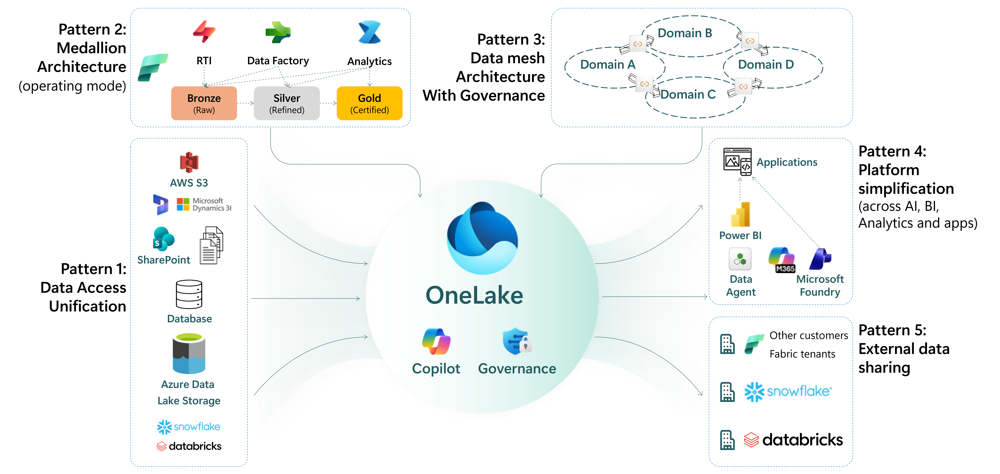
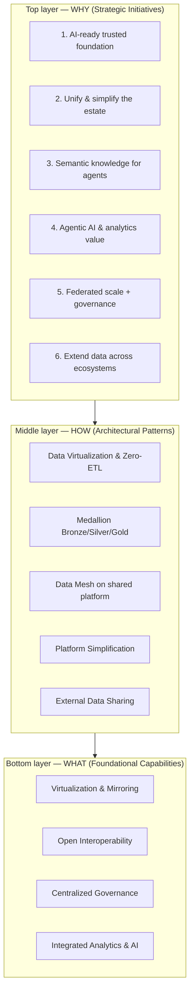

# Reference Architecture: OneLake Architectural Guidance Framework

Based on the **OneLake Architectural Guidance Whitepaper** and the [Microsoft OneLake documentation](https://learn.microsoft.com/en-us/fabric/onelake/onelake-overview).

## Overview

OneLake is the single, unified, logical data layer underpinning Microsoft Fabric — one governed data foundation that serves every analytics workload (BI, data engineering, data science, real-time intelligence, and AI) while integrating across clouds and on-premises platforms. It ships with a built-in catalog for discoverability and comprehensive security and governance.

This framework connects **business intent to architecture decisions** through three layers. Read top-down, it answers three questions in order:

| Layer | Question it answers |
|-------|--------------------|
| **Strategic Enterprise Initiatives** | *Why* should the enterprise care? |
| **Proven Architectural Patterns** | *How* do we architect to solve common data challenges? |
| **Foundational Capabilities** | *What* does OneLake provide to implement the patterns? |

Use it as a decision aid: start from the initiative you're pursuing, select the pattern(s) that respond to it, then implement with the named OneLake/Fabric capabilities. OneLake matters not as a collection of isolated features, but as a governed data foundation that enables repeatable patterns in support of durable business priorities — a strategic platform decision, not a point-technology choice.

## Architecture diagram

The same three-layer flow, rendered inline:

---

## Top layer: Strategic Enterprise Initiatives

As organizations move from isolated AI experiments to production-ready, agent-driven systems, the bottleneck is no longer model capability — it's consistent, shared data context. Six enterprise-wide imperatives drive every architectural decision in this framework.

| # | Initiative | What it means | Architecture implication |
|---|-----------|---------------|--------------------------|
| **1** | **Build an AI-ready, trusted data foundation** | Turn governed data into faster decisions and measurable outcomes. Agents synthesize information rather than create it, so accuracy depends entirely on source quality and accessibility. | Align data investments with enterprise architecture and business strategy, not just experimentation. Govern before you ground AI. |
| **2** | **Unify, modernize, and simplify the data estate** | Converge transactional, operational, and analytical data under one consistent architecture — not just consolidated analytics. | Eliminate duplicate pipelines, conflicting datasets, and parallel environments; treat the platform as a unified decision engine. |
| **3** | **Transform data into semantic knowledge agents can reason over** | Centralizing data is now the *starting* point. Agents demand rich, contextualized data grounded in business operations (Microsoft IQ: Work IQ, Fabric IQ, Foundry IQ). | Add an ontology-based semantic layer (Fabric IQ) over OneLake so humans and agents share a governed understanding of business reality. |
| **4** | **Accelerate business value through agentic AI and analytics** | Move beyond assistive Copilots toward autonomous agents that reason, plan, act, and collaborate. Journey: Unify → Curate Semantic Knowledge → Empower Agents. | Design for a human-led, agent-operated model with humans providing oversight and accountability. |
| **5** | **Enable federated scale with governance and reusable data products** | Let domains move faster while staying aligned to central standards and shared semantics — governing both human users *and* AI agents. | Publish reusable data products; apply agent governance (identity, lifecycle, observability, runtime policy) for fleets of agents. |
| **6** | **Extend trusted data across business ecosystems and the open agentic web** | Share curated data products securely with partners, suppliers, and customers without losing control. | Keep shared data governed, auditable, and secure; use open protocols (e.g., MCP) for cross-system interoperability. |

---

## Middle layer: Proven Architectural Patterns

Five reusable patterns, drawn from production OneLake deployments, describe how customers implement the right architecture for common data challenges. Patterns compose — most enterprises combine several.

### Pattern 1 — Data Virtualization (unify without moving data)

**Definition:** Unify disconnected systems by referencing data in place with OneLake shortcuts (internal and external), defaulting to virtualization and replicating only when a physical, query-optimized copy is required.

**Key benefits:** Unify cloud and on-premises systems without copying/replicating; cut onboarding time; retire legacy pipelines and workflows; process data in place.

> **In practice:** A global healthcare distributor unified ten disconnected systems (cloud ERPs + on-prem platforms) with internal/external shortcuts — no data movement — cutting onboarding time ~40% and retiring hundreds of legacy workflows. A global quick-service restaurant chain replaced large ingestion pipelines with shortcuts to AWS S3 JSON and Apache Iceberg tables, processing billions of rows in place from Fabric Spark notebooks and reducing forecasting time ~80% across 5,000+ stores.

### Pattern 2 — Medallion Architecture (Bronze / Silver / Gold)

**Definition:** Adopt a layered Bronze/Silver/Gold model as the standard operating model for analytics on OneLake. Bronze holds raw, immutable source data; Silver holds cleansed, conformed, business-aligned data; Gold holds certified, business-ready datasets and semantic models for BI, analytics, and AI.

**Key benefits:** Improves data quality and consistency; enables reuse across teams on shared Silver/Gold assets; provides a single source of truth; strengthens lineage so every Gold metric traces back to Bronze.

> See the repo's [Medallion Architecture best practice](../best-practices/medallion-architecture.md) and [End-to-End Medallion reference architecture](end-to-end-medallion.md) for implementation detail.

### Pattern 3 — Data Mesh on a Shared, Governed Platform

**Definition:** A domain-oriented architecture where business domains own their data products while operating on a single, shared, governed OneLake foundation. Internal shortcuts and domains let producing teams publish curated products that others consume without copying data, under centrally defined governance.

**Key benefits:** Scales data ownership across teams; improves accountability and quality; enables reuse and discovery across domains; reduces dependence on a central team; preserves enterprise-wide governance even as authority is federated.

> **In practice:** A global software/content-management provider built a certified data mesh in Fabric — a central platform team curates the foundation while Finance, Marketing, Customer Success, and Sales domains build on a single certified Gold layer with zero data duplication. A global enterprise with twelve digital platforms consolidated onto a domain-aligned Fabric environment (per-platform workspaces and capacity) publishing data products into a shared OneLake via ADLS Gen2 shortcuts, selective mirroring, and custom ACL automation.

### Pattern 4 — Platform Simplification across AI & Analytics

**Definition:** Consolidate analytics, data engineering, data science, and BI onto a single OneLake-based platform, retiring overlapping legacy tools, warehouses, and bespoke pipelines. One governed data copy serves analytics, AI, and operational reporting.

**Key benefits:** Lower total cost of ownership (fewer licenses, pipelines, and hand-offs); simpler operations and faster onboarding; one governance and security model; faster time-to-insight via Direct Lake and integrated semantic models. Curated Power BI semantic models can jump-start Fabric IQ ontologies that ground agentic AI (in Fabric Data Agents, M365 Copilot, Microsoft Foundry, or external tools via the Ontology MCP Server).

> **In practice:** A national retail chain replaced a Snowflake-based reporting stack with a OneLake-centric Fabric platform — virtualizing analytical data as Iceberg tables in ADLS Gen2 via shortcuts and rebuilding reports on Power BI Direct Lake — removing 1.5-hour refresh cycles and lowering cost. A global semiconductor company consolidated ERP, CRM, demand-planning, and financial sources onto one governed medallion lakehouse with Direct Lake semantic models.

### Pattern 5 — External Data Sharing Across Business Ecosystems

**Definition:** Secure, governed sharing across organizational or tenant boundaries with no copies or manual exports. The producer publishes data products (often curated Gold); external parties access them in their own analytics environment via a shortcut while the data physically remains in the producer's OneLake.

**Key benefits:** Turns slow batch exports into live, real-time collaboration; reduces integration complexity and duplication; opens new data-sharing and monetization models; preserves centralized governance over what is shared, with whom, and under what conditions.

> **In practice:** A global heavy-equipment manufacturer used OneLake External Data Sharing to give each dealer secure, bidirectional, zero-copy access to corporate Dataverse and operational data via Fabric Link, using Iceberg shortcuts and mirroring to interoperate with a corporate Snowflake environment across 20+ dealers. A global field-services enterprise established a hub-and-spoke OneLake architecture governing zero-copy cross-tenant virtualization, selectively sharing curated datasets with external partners.

---

## Bottom layer: Foundational Capabilities

These capabilities define *what* OneLake and Fabric provide to implement the patterns consistently at enterprise scale.

### Capability 1 — Data Virtualization and Zero-ETL Mirroring

OneLake connects distributed data into a single namespace through two complementary modes: **virtualization** (reference data in place, no copy) and **zero-ETL replication** (bring external data in as analytics-ready Delta tables with no user-managed pipelines). Default to virtualization; add replication selectively when a physical, query-optimized copy is required.

| Feature | Purpose |
|---------|---------|
| [OneLake shortcuts](https://learn.microsoft.com/en-us/fabric/onelake/onelake-shortcuts) | Symbolic-link objects pointing to data in OneLake or external sources |
| [Shortcut file transformations](https://learn.microsoft.com/en-us/fabric/onelake/shortcuts/transformations) | Convert structured files into Delta tables via shortcuts |
| [Shortcut AI transformations](https://learn.microsoft.com/en-us/fabric/onelake/shortcuts/transformations-ai) | AI-driven enrichment over unstructured text file shortcuts |
| [External data sharing](https://learn.microsoft.com/en-us/fabric/governance/external-data-sharing-overview) | Share OneLake data in-place from a provider tenant to a consumer tenant |
| [Database mirroring](https://learn.microsoft.com/en-us/fabric/mirroring/overview) | Near-real-time replication of entire databases and tables into OneLake |
| Metadata mirroring | Synchronize only catalog metadata; reference source data in place via shortcuts — no copy, no ETL |
| [Open mirroring](https://learn.microsoft.com/en-us/fabric/mirroring/open-mirroring) | API-based approach for any app/provider to write change data into a mirrored database using open Delta Lake format |

**Supported mirroring sources** include Azure SQL Database, Azure SQL Managed Instance, Azure Cosmos DB, Azure Database for PostgreSQL, [Azure Database for MySQL (preview)](https://learn.microsoft.com/en-us/fabric/mirroring/azure-database-mysql), Fabric SQL database, SQL Server, Snowflake, Oracle, SAP, and [Google BigQuery](https://learn.microsoft.com/en-us/fabric/mirroring/google-bigquery). Azure Databricks and [Dremio (preview)](https://learn.microsoft.com/en-us/fabric/mirroring/catalog-mirroring/dremio) support metadata mirroring; applications can also implement Open mirroring. See [getting started with mirroring](https://learn.microsoft.com/en-us/fabric/mirroring/get-started-with-mirroring) for the current source list.

### Capability 2 — Open Data Interoperability

Data stored in OneLake's open formats — **Delta Parquet** and **Apache Iceberg** — is accessible by Fabric's built-in engines and by external platforms (Databricks, Snowflake, Microsoft Foundry, and any engine speaking the open standard).

| Feature | Purpose |
|---------|---------|
| [Open table formats (Iceberg / Delta)](https://learn.microsoft.com/en-us/fabric/onelake/onelake-iceberg-tables) | Native Iceberg tables in OneLake and Delta Parquet support |
| [OneLake access and APIs](https://learn.microsoft.com/en-us/fabric/onelake/onelake-access-api) | REST, ADLS Gen2 API, and SDK access for any compliant engine |
| [Integrate OneLake with Azure Databricks](https://learn.microsoft.com/en-us/fabric/onelake/onelake-azure-databricks) | Bidirectional integration with Databricks Unity Catalog |
| [Use Iceberg tables with Snowflake](https://learn.microsoft.com/en-us/fabric/onelake/onelake-iceberg-tables) | Snowflake interoperability via shared Iceberg table formats |
| [OneLake for Microsoft Foundry](https://learn.microsoft.com/en-us/fabric/onelake/onelake-overview) | Use OneLake files as a knowledge source for Foundry agents |
| [Catalog virtualization via Table API (Iceberg REST Catalog)](https://learn.microsoft.com/en-us/fabric/onelake/table-apis/table-apis-overview) | Third-party catalog and engine integration |

### Capability 3 — Centralized Governance

OneLake applies policies, access control, lineage, and audit at the **data layer**, so the same governance applies regardless of which engine or experience consumes the data.

| Feature | Purpose |
|---------|---------|
| [Fabric governance overview](https://learn.microsoft.com/en-us/fabric/governance/governance-compliance-overview) | Entry point for Fabric/OneLake governance and compliance |
| [OneLake security](https://learn.microsoft.com/en-us/fabric/onelake/security/get-started-security) | Role-based, table/folder, row-level (RLS), and column-level (CLS) controls |
| [Data access control model](https://learn.microsoft.com/en-us/fabric/onelake/security/data-access-control-model) | Authoritative model for OneLake security policies |
| [Domains](https://learn.microsoft.com/en-us/fabric/governance/domains) | Logical groupings of workspaces aligned to business domains for federated governance |
| [Microsoft Purview for Fabric](https://learn.microsoft.com/en-us/fabric/governance/microsoft-purview-fabric) | Sensitivity labels, insider risk, AI data-leak prevention, and auditing |
| [OneLake catalog](https://learn.microsoft.com/en-us/fabric/governance/onelake-catalog-overview) | Central discovery, lineage view, and Govern tab for tenant-wide insights |
| [Customer-managed keys (CMK)](https://learn.microsoft.com/en-us/fabric/security/security-scenario) | Encrypt data at rest with organization-controlled keys |
| [Data lifecycle management](https://learn.microsoft.com/en-us/fabric/onelake/onelake-storage-tiers) | Storage tiers and policies for hot, cool, and cold data |

### Capability 4 — Integrated Analytics and AI

BI, data engineering, data science, real-time intelligence, and AI operate on the **same governed data** without copying it into specialized stores.

| Feature | Purpose |
|---------|---------|
| [Direct Lake mode](https://learn.microsoft.com/en-us/fabric/fundamentals/direct-lake-overview) | Power BI semantic models query Delta tables in OneLake directly — in-memory performance with live freshness |
| [Medallion lakehouse architecture](https://learn.microsoft.com/en-us/fabric/onelake/onelake-medallion-lakehouse-architecture) | Recommended Bronze/Silver/Gold design pattern in OneLake |
| Ontologies (Fabric IQ) | Shared enterprise semantic layer of entities, properties, and relationships bound to OneLake data so humans and AI reason consistently across domains |
| Ontology MCP Server | Standard protocol/API letting external AI tools discover and interact with the ontology's business context |
| [Data Factory](https://learn.microsoft.com/en-us/fabric/data-factory/data-factory-overview) | Data integration and orchestration |
| [Data Engineering (Spark)](https://learn.microsoft.com/en-us/fabric/data-engineering/data-engineering-overview) | Notebooks, environments, and lakehouse management |
| [Data Warehouse (T-SQL)](https://learn.microsoft.com/en-us/fabric/data-warehouse/data-warehousing) | SQL on open data formats |
| [Real-Time Intelligence (KQL)](https://learn.microsoft.com/en-us/fabric/real-time-intelligence/overview) | Eventhouses, KQL databases, and Data Activator |
| [Data Science](https://learn.microsoft.com/en-us/fabric/data-science/data-science-overview) | ML model training, deployment, and experiment tracking |
| [Fabric Data Agents](https://learn.microsoft.com/en-us/fabric/data-science/concept-data-agent) | Conversational AI agents that reason over enterprise data in natural language |
| [Copilot for Fabric](https://learn.microsoft.com/en-us/fabric/fundamentals/copilot-fabric-overview) | Generative AI assistance embedded in every Fabric workload |

---

## How to use this framework in a design review

1. **Anchor on the initiative** — Identify which of the six strategic initiatives the design is meant to advance. This clarifies the outcome, not just the tooling.
2. **Select the pattern(s)** — Map the challenge to one or more of the five patterns. Patterns compose (e.g., a Data Mesh built on Medallion layers, shared externally).
3. **Implement with capabilities** — Choose the named OneLake/Fabric capabilities. **Default to virtualization; replicate selectively.**
4. **Validate against the repo's guidance** — Cross-check with [patterns-comparison.md](patterns-comparison.md) and scan for [anti-patterns](../anti-patterns/) such as [bypassing OneLake](../anti-patterns/bypassing-onelake.md).
5. **Govern before grounding AI** — For agentic scenarios, confirm a governed semantic layer (ontology/Fabric IQ) sits over Gold before exposing data to agents.

## Related guidance in this repo

- [OneLake Shortcuts best practice](../best-practices/onelake-shortcuts.md)
- [Medallion Architecture best practice](../best-practices/medallion-architecture.md)
- [Direct Lake best practice](../best-practices/direct-lake.md)
- [Governance best practice](../best-practices/governance.md)
- [End-to-End Medallion reference architecture](end-to-end-medallion.md)
- [Patterns comparison matrix](patterns-comparison.md)
- [Data architecture for Fabric Data Agents](../fabric-data-agents/data-architecture-for-agents.md)

## References

- [Microsoft OneLake](https://learn.microsoft.com/en-us/fabric/onelake/onelake-overview)
- [Fabric governance](https://learn.microsoft.com/en-us/fabric/governance/governance-compliance-overview)
- [Fabric fundamentals](https://learn.microsoft.com/en-us/fabric/fundamentals/)
- [Microsoft Fabric documentation](https://learn.microsoft.com/en-us/fabric/)
- [Medallion lakehouse architecture](https://learn.microsoft.com/en-us/fabric/onelake/onelake-medallion-lakehouse-architecture)
- [OneLake external data sharing](https://learn.microsoft.com/en-us/fabric/governance/external-data-sharing-overview)
- [Direct Lake overview](https://learn.microsoft.com/en-us/fabric/fundamentals/direct-lake-overview)
