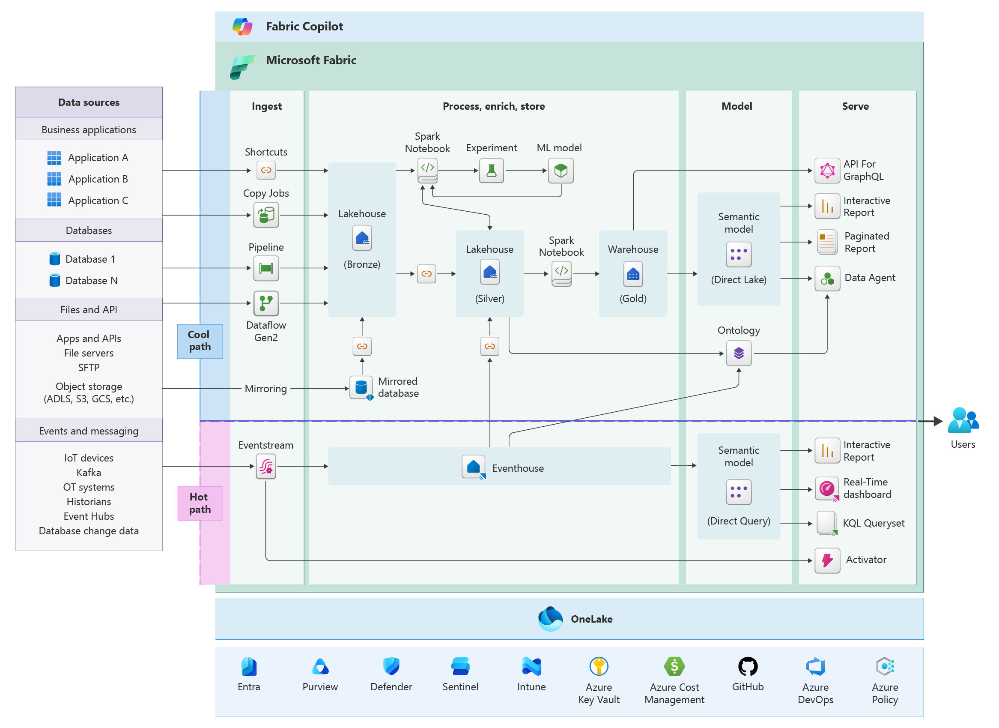

# Reference Architecture: Well-Architected Framework for Fabric

Based on [Microsoft Fabric Well-Architected Framework](https://learn.microsoft.com/en-us/azure/well-architected/microsoft-fabric/overview)

## Overview

The Well-Architected Framework provides design guidance across five pillars. In Fabric, architectural decisions have wide impact because capacity sizing affects both pipelines and queries, data design influences refresh times and report performance, and security configuration determines how teams collaborate.

## Architecture pattern

The diagram above shows a typical architecture for workloads running on Microsoft Fabric, illustrating how ingestion, transformation, storage (OneLake), and consumption layers connect across a shared capacity.

## Five pillars applied to Fabric

### 1. Reliability

**Goal:** Maintain predictable availability and recover gracefully from failures.

| Practice | Implementation |
|----------|---------------|
| Multi-region capacities | Deploy capacities in paired regions for DR |
| Data replication | OneLake BCDR with geo-redundant storage |
| Failover strategies | Secondary workspace with mirrored content |
| Retry logic | Built-in pipeline retries + alerting on failures |
| Modular pipelines | Isolate stages so failures don't cascade |

**Key questions:**
- What's your RTO/RPO for analytics workloads?
- Which datasets are mission-critical vs. best-effort?
- Do you have a documented failover procedure?

### 2. Security

**Goal:** Protect data, identities, and workloads.

| Practice | Implementation |
|----------|---------------|
| Workspace isolation | Separate workspaces per layer and/or domain |
| Role-based access | Fabric workspace roles + item-level permissions |
| Managed identities | Service principals for pipelines, no shared accounts |
| Encryption | At-rest (default) + in-transit (TLS) |
| Secure networking | Private endpoints, VNet data gateways |
| Continuous monitoring | Audit logs → Log Analytics → alerts |

**Key questions:**
- Is access controlled via Azure AD groups (not individuals)?
- Are managed identities used for all automated processes?
- Is PII masked/tokenized before the Gold layer?

### 3. Cost Optimization

**Goal:** Control spending while meeting performance requirements.

| Practice | Implementation |
|----------|---------------|
| Right-size capacity | Match F-SKU to actual CU consumption patterns |
| Workload scheduling | Heavy jobs in off-peak hours (smoothing) |
| Auto-pause | Pause capacity during non-business hours where feasible |
| Monitor utilization | Fabric Capacity Metrics app |
| Retention policies | Don't store unlimited history — define TTL per layer |
| Shared vs. dedicated | Share capacity for light workloads; isolate heavy ones |

**Key questions:**
- Are you monitoring CU utilization daily?
- Could off-peak scheduling reduce peak CU demand?
- Are there idle or orphaned items consuming capacity?

### 4. Operational Excellence

**Goal:** Deploy and operate with confidence.

| Practice | Implementation |
|----------|---------------|
| Git integration | All artifacts in source control |
| Deployment pipelines | Dev → Test → Prod promotion with gates |
| Automated testing | Data quality checks, report validation |
| Progressive rollouts | Canary/ring deployment for major changes |
| Monitoring & alerting | Pipeline failures, refresh failures, CU spikes |
| Incident response | Runbooks for common failure scenarios |

**Key questions:**
- Are all artifacts under version control?
- Is there a documented deployment process?
- Do you have runbooks for the top 5 failure scenarios?

### 5. Performance Efficiency

**Goal:** Scale and respond efficiently.

| Practice | Implementation |
|----------|---------------|
| Capacity right-sizing | Use Capacity Metrics to identify bottlenecks |
| Workload isolation | Separate capacity for heavy Spark jobs vs. BI |
| Query optimization | Delta OPTIMIZE, Z-ORDER, V-Order |
| Direct Lake | Avoid refresh overhead; near-real-time access |
| Incremental processing | Only process new/changed data per run |
| Caching | Direct Lake in-memory caching for hot data |
| Bursting | Allow temporary CU bursting for peak demand |

**Key questions:**
- Are your largest tables optimized (OPTIMIZE, V-Order)?
- Is Direct Lake properly framed (no unexpected fallback)?
- Are Spark jobs and BI queries on separate capacities?

## Common architectural challenges

| Challenge | Mitigation |
|-----------|-----------|
| Unchecked data growth | Governance policies, retention rules, monitoring |
| Cross-workload resource contention | Capacity isolation, workload scheduling |
| Unpredictable performance on shared capacity | Separate interactive (BI) from batch (engineering) |
| Complex hybrid/on-prem integration | Standardize on OneLake + gateways, minimize patterns |
| Inconsistent team adoption | Operating model, COE, training, standards |

## Design methodology (summary)

1. **Focus on critical workflows** — Identify where latency matters and failures have the greatest impact
2. **Design for shared capacity** — Prevent heavy workloads from starving interactive operations
3. **Keep workloads modular** — Smaller, independent components reduce blast radius
4. **Observe and adapt** — Monitor utilization and optimize as data volumes grow

## References

- [Well-Architected: Reliability](https://learn.microsoft.com/en-us/azure/well-architected/microsoft-fabric/reliability)
- [Well-Architected: Security](https://learn.microsoft.com/en-us/azure/well-architected/microsoft-fabric/security)
- [Well-Architected: Cost Optimization](https://learn.microsoft.com/en-us/azure/well-architected/microsoft-fabric/cost-optimization)
- [Well-Architected: Operational Excellence](https://learn.microsoft.com/en-us/azure/well-architected/microsoft-fabric/operational-excellence)
- [Well-Architected: Performance Efficiency](https://learn.microsoft.com/en-us/azure/well-architected/microsoft-fabric/performance-efficiency)
